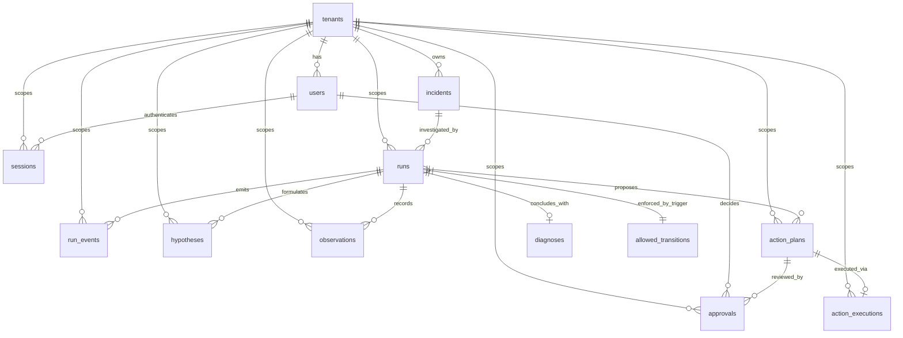

# OpsPilot

### Problem Statement
Modern cloud-native systems face complex production incidents where critical diagnostic context is scattered across disparate logs, metrics, and traces. Autonomous agents powered by large language models offer rapid investigation, but granting them unrestricted shell access or cloud credentials risks catastrophic failures, hallucinations, and unsafe system mutations. OpsPilot resolves this dilemma by enforcing deterministic safety boundaries: the LLM only investigates and proposes structured recovery plans, while policy authorization, exact-plan human approval, narrow execution, and outcome verification are strictly governed by deterministic code outside the model.

---


### Architecture at a Glance

```
                +-------------------------------------------------+
                |                   Review UI                     |
                |               (React + Vite + TS)               |
                +-----------------------+-------------------------+
                                        | HTTP (Port 5173 -> 8000)
                                        v
+---------------------------------------+---------------------------------------+
|  CORE (Network: core)                 |                                       |
|                                       v                                       |
|                              +-----------------+                              |
|                              |   FastAPI App   |                              |
|                              |   (apps/api)    |                              |
|                              +--------+--------+                              |
|                                       |                                       |
|           +---------------------------+---------------------------+           |
|           v                                                       v           |
|   +---------------+                                       +---------------+   |
|   |  PostgreSQL   | <--- Alembic Migrations               |     Redis     |   |
|   |   (Port 5432) |                                       |  (Port 6379)  |   |
|   +---------------+                                       +---------------+   |
|           ^                                                       ^           |
|           | Checkpoints & State (FOR UPDATE SKIP LOCKED)          | Cache     |
|   +-------+-----------------------+                               |           |
|   | Worker Daemon (agent/worker)  |                               |           |
|   |   LangGraph Investigator Core |                               |           |
|   |   [load_context -> plan_step  |                               |           |
|   |    -> call_tool -> record     |                               |           |
|   |    -> conclude -> finalize]   |                               |           |
|   +-------+-----------------------+                               |           |
|           |                       |                               |           |
|           v                       v                               |           |
|   +---------------+       +---------------+                       |           |
|   |  LLM Adapter  |       | Tool Registry |                       |           |
|   |  (agent/llm)  |       | (tools/ - F2) |                       |           |
|   | GeminiClient/ |       | Read-only     |                       |           |
|   | FakeLLMClient |       | bounded tools |                       |           |
|   +---------------+       +---------------+                       |           |
|                                                                               |
+-------------------------------------------------------------------------------+
                                        | (Proposals via Database/API)
                                        v
+-------------------------------------------------------------------------------+
|  BROKER (Network: broker only)                                                |
|                                                                               |
|   +---------------+  Approved Action Only  +--------------------------------+ |
|   | Action Broker | ---------------------> | Toy Lab Services & Fault Inject| |
|   | (broker/)     |                        | (lab/ - Feature 1)             | |
|   +---------------+                        +--------------------------------+ |
|   * Docker socket mounted ONLY here                                           |
+-------------------------------------------------------------------------------+
```

#### Relational Data Model & Security Schema

The database partitions business domain records and LangGraph state into distinct schemas (`app` and `checkpoints`) with row-level security (`FORCE ROW LEVEL SECURITY`) and database trigger-enforced invariants:



---

### Quickstart

#### Prerequisites
- Docker & Docker Compose v2+
- Python 3.12+ and `uv`
- Node.js 22+ and `npm`

#### 1. Setup Environment
```bash
cp .env.example .env
```

#### 2. Install Dependencies
```bash
# Backend toolchain (uv)
make install

# Web UI dependencies (npm)
make web-install
```

#### 3. Start Infrastructure, Migrations, and API
```bash
make up
```
This command starts PostgreSQL 17 and Redis 7 in Docker, waits for PostgreSQL to become healthy, applies Alembic database migrations (`uv run alembic upgrade head`), and starts the FastAPI service at `http://127.0.0.1:8000`.

#### 4. Verify Readiness
```bash
curl http://127.0.0.1:8000/readyz
# {"status":"ok","dependencies":{"postgres":"ok","redis":"ok"}}
```

#### 5. Launch the Review UI (in another terminal)
```bash
make web-dev
# Open http://localhost:5173 in your browser
```

#### 6. Stop and Clean Up
```bash
# Stop containers and preserve volumes
make down

# Wipe data volumes (requires interactive confirmation)
make reset
```

---

### Baseline Results Summary

The baseline ladder measures non-agent performance across three benchmark rungs on scenarios S1–S5 (see full details in [docs/baseline_report.md](docs/baseline_report.md) and design in [docs/baseline_design.md](docs/baseline_design.md)):
- **B0 (Alert-Only)**: Fires on threshold breach and reflexively escalates to human on-call without investigation.
- **B1 (Deterministic Runbook)**: Fixed 5-rule engineering flowchart using at most 4 bounded tool calls (zero LLM).
- **B2 (No-Tools LLM)**: Single structured Gemini call receiving only the alert and static architecture description (zero investigative tools or telemetry queries).

#### Benchmark Totals (Numerator / Denominator)

| Variant | Diagnosis Correct | Diagnosis Partial | Diagnosis Abstained | Action Correct | Unnecessary Actions | Provider Errors |
| :--- | :--- | :--- | :--- | :--- | :--- | :--- |
| **B0** | 0/5 | 0/5 | 5/5 | 0/5 | 0/5 | 0/5 |
| **B1** | 3/5 | 2/5 | 0/5 | 5/5 | 0/5 | 0/5 |
| **B2** | 0/5 | 0/5 | 0/5 | 0/5 | 0/5 | 5/5 |

*Note: B2 live runs encountered 5/5 provider errors because `GEMINI_API_KEY` was not configured in the test environment (counted strictly as provider errors, never marked as wrong diagnoses). Deterministic offline behavior is validated via `FakeLLMClient`.*

#### Honest Benchmark Limitations
1. **Development Set Only**: All five scenarios (S1–S5) are development cases; the sealed test split is assigned in Feature 13.
2. **Small Sample Size ($N=5$)**: Five incidents cannot establish statistical significance ($p < 0.05$) or tight confidence intervals.
3. **Dry-Run Actions**: Evaluated against canonical expectations; no active container mutations were executed.
4. **Pre-Committed Gate**: The agent value gate ([docs/agent_value_gate.md](docs/agent_value_gate.md)) was committed **before** the agent exists.

---

### Development Commands

| Target | Command | Purpose |
| :--- | :--- | :--- |
| `make install` | `uv sync --extra dev` | Install pinned backend Python toolchain |
| `make lint` | `uv run ruff check .` | Run Ruff linter across Python code |
| `make typecheck` | `uv run mypy apps agent tests` | Run Mypy strict typechecking |
| `make test` | `uv run pytest -v` | Run full backend test suite offline |
| `make migrate` | `uv run alembic upgrade head` | Run Alembic database migrations |
| `make db-up` | Docker up postgres | Spin up core PostgreSQL container and await healthcheck |
| `make db-migrate` | `uv run alembic upgrade head` | Apply pending Alembic migrations |
| `make db-reset` | Drop schema + Alembic head | Cleanly reset schema and apply all migrations to head |
| `make db-seed` | `uv run python scripts/seed_dev.py` | Seed deterministic tenants, users, and credentials |
| `make test-backbone` | `uv run pytest tests/backbone/test_lifecycle.py -v` | Run scripted lifecycle driver, negative paths, and 200-run load check |
| `make test-agent` | `uv run pytest tests/test_agent_*.py tests/test_worker_*.py ...` | Run offline investigator agent and worker integration tests |
| `make worker` | `uv run python -m agent.worker` | Run background investigator worker daemon |
| `make run-offline-demo` | `uv run python scripts/demo_offline_investigator.py` | Run deterministic end-to-end offline investigation demo |
| `make web-install`| `cd apps/web && npm install` | Install React frontend packages |
| `make web-lint` | `cd apps/web && npm run lint` | Run ESLint on frontend code |
| `make web-test` | `cd apps/web && npm test` | Run Vitest unit tests |
| `make up` | Docker + Alembic + API | Spin up full local development stack |
| `make down` | Docker Compose down | Gracefully stop local containers |
| `make reset` | Docker Compose down -v | Wipe persistent volumes with prompt |

---

### Status & Backlog

- [x] **Feature 0: Foundation Complete**
  - Monorepo directory skeleton and Docker socket boundary guard
  - Docker Compose core services (PostgreSQL 17, Redis 7) bound to `127.0.0.1`
  - FastAPI backend with structured JSON logging, sensitive data redaction, `/healthz`, and `/readyz`
  - React + Vite + TypeScript review UI scaffold with dependency readiness dashboard
  - Outcome contract and deterministic state machine specification ([docs/outcome_contract.md](docs/outcome_contract.md))
  - Architectural decisions log ([docs/DECISIONS.md](docs/DECISIONS.md))
  - Provider-isolated LLM adapter with Google GenAI SDK, offline deterministic replay client, retry/backoff, and token budget guard
  - Alembic baseline migrations wired to `DATABASE_URL`
  - GitHub Actions CI workflow and pre-commit secret scanning hooks
- [x] **Feature 1: Synthetic Microservice Lab & Evaluation Substrate Complete**
  - Toy microservices (`gateway`, `orders`, `inventory`) with W3C trace propagation, connection pool limits, and telemetry
  - Telemetry collection: Prometheus scraping (5s), OpenTelemetry collector exporting JSONL spans, and correlated structured JSON logs
  - In-process deploy and rollback primitives (`lab.controller_lib`) with version profiles (`v1.0.0`-`v1.3.0`) and non-incriminating diffs
  - Open-loop load generator (`lab.loadgen`) with deterministic Zipf product distributions and named YAML profiles
  - Segregated scenario controller on `lab-admin` and isolated SQLite Ground-Truth Vault (`vault.db`) with token protection
  - Formal scenario schema and 5 scenario definitions (`S1`-`S5`) covering all failure families
  - Deterministic evaluation graders (`evals/graders/`) for diagnosis, evidence support, recovery, and safety
  - Zero-leakage evidence exporter (`scripts/export_evidence.py`) and leak test suite
  - Blind diagnosis kit (`scripts/blind_kit.py`), verified human diagnosis log, and evidence requirements contract ([docs/evidence_requirements.md](docs/evidence_requirements.md))
  - Full lab architecture, version profiles, and failure signature report ([docs/LAB_REPORT.md](docs/LAB_REPORT.md))
  - End-to-end scenario lifecycle test suite (`tests/lab_e2e`) with fast CI and nightly workflows
  - Lab management targets: `make lab-up`, `make lab-down`, `make lab-smoke`
- [x] **Feature 2: Bounded Read Tools & Evidence Store Complete**
  - Bounded read tools: `get_metrics`, `search_logs`, `get_trace`, `list_deploys`, `get_deploy_diff`
  - Untrusted data quarantine with closing tag escape and prompt-injection detection
  - Secret redaction across tools and persistence (`[REDACTED:<type>]`)
  - Server-side tool registry with model-facing schema generation, call budget enforcement ($\le 8$), and duplicate-call caching
  - Telemetry backends (`SnapshotBackend` for offline/evals, `LiveBackend` with fixed PromQL templates)
  - Append-only JSONL evidence store with tenant/run isolation
  - 8-case adversarial and security test suite ([tests/test_tools_adversarial.py](tests/test_tools_adversarial.py))
  - Deterministic scripted investigator proof (5/5 scenarios diagnosed within budget, [docs/tool_eval_report.md](docs/tool_eval_report.md))
  - Full tool inventory and guarantees report ([docs/TOOLS_REPORT.md](docs/TOOLS_REPORT.md))
- [x] **Feature 3: Baseline Evaluation Ladder & Pre-Commitment Gate Complete**
  - Baseline ladder variants: B0 (alert-only / escalate), B1 (deterministic 5-rule runbook with bounded tools), B2 (no-tools structured LLM prompt)
  - Deterministic Prometheus threshold alert evaluator ([baseline/alerts/](baseline/alerts/)) tuned solely against healthy baseline traffic
  - Fixed action vocabulary in [shared/actions.py](shared/actions.py) (`rollback_service`, `restart_service`, `no_action`, `escalate`) with 4-way grading (`correct`, `unnecessary`, `wrong-target`, `missing`)
  - Frozen and committed B1 runbook hash (`26d4a361...`) and B2 prompt hash (`b4290a1a...`) committed before first benchmark run
  - Automated evaluation runner ([evals/baseline_runner.py](evals/baseline_runner.py)) with strict isolation, dry-run safety, and fraction reporting
  - Committed Agent Value Gate targets ([docs/agent_value_gate.md](docs/agent_value_gate.md)) frozen before the agent exists
  - Full baseline evaluation report ([docs/baseline_report.md](docs/baseline_report.md))
- [x] **Feature 4: PostgreSQL Data Model, Invariants, REST API & Backbone Complete**
  - Dual-schema PostgreSQL model (`app` and `checkpoints`) with UUID primary keys and timestamped entities
  - Strict Row-Level Security (`FORCE ROW LEVEL SECURITY`) across all tenant-scoped tables with session context injection
  - Database invariant triggers: plan immutability, canonical SHA-256 plan hash cross-verification, transition enforcement against `app.allowed_transitions`, append-only run events and observations, and delete-rejection on approvals and executions
  - Pinned Argon2id password hashing, opaque session cookies, CSRF protection, and role-based access control (`viewer`, `reviewer`, `admin`)
  - REST API router layer with consistent error envelopes, cursor pagination, and SSE streaming with 15s heartbeats
  - Production-grade `PostgresEvidenceStore` with 64 KB inline caps and artifact file references
  - Scripted lifecycle backbone driver (`tests/backbone/test_lifecycle.py`), 200 concurrent runs load test, and database integrity script (`scripts/db_invariants.py`)
  - Full data model, security, and invariant report ([docs/DATA_MODEL_REPORT.md](docs/DATA_MODEL_REPORT.md))
- [x] **Feature 5: Autonomous Incident Investigator Agent & Evaluation Substrate Complete**
  - Compiled LangGraph investigator graph (`load_context -> plan_step -> (call_tool -> record -> plan_step)* -> conclude -> finalize -> handoff`)
  - Typed `InvestigationState` with immutable references, summaries, audit traces, and budget counters
  - Discriminated union step schemas (`CallToolStep` with allowlisted read tools, `ConcludeStep` with Feature 1.12 `Diagnosis` artifact)
  - Zero-leakage context assembler ([agent/graph/context.py](agent/graph/context.py)) with progressive compaction and protected evidence preservation
  - Deterministic prompt version governance ([agent/prompts/investigator_system_v1.md](agent/prompts/investigator_system_v1.md), hash `7c065736...`)
  - Background worker daemon ([agent/worker.py](agent/worker.py)) claiming queued runs via `SELECT ... FOR UPDATE SKIP LOCKED` with heartbeats and timeout watchdogs
  - End-to-end evaluation runner ([evals/investigator_runner.py](evals/investigator_runner.py)) and comprehensive evaluation report ([docs/INVESTIGATOR_REPORT.md](docs/INVESTIGATOR_REPORT.md))
  - 64-case offline agent test suite ([tests/test_investigator_loop_deterministic.py](tests/test_investigator_loop_deterministic.py), [tests/test_worker_and_graph.py](tests/test_worker_and_graph.py))
- [ ] **Feature 6: Hypothesis Tracking & Contrary Evidence Formulation** (Dual-hypothesis generation, disconfirming telemetry checks, candidate v2 prompt)
- [ ] **Feature 7: Action Proposals, Remediation Planning & Approval Gates** (Action vocabulary planning, cryptographic plan hashes, human approval gate)
- [ ] **Feature 8: Durable Resume, Checkpointing & Recovery Engine** (LangGraph PostgreSQL checkpoint persistence, pause-and-resume workflows)
