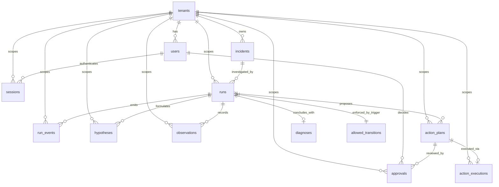
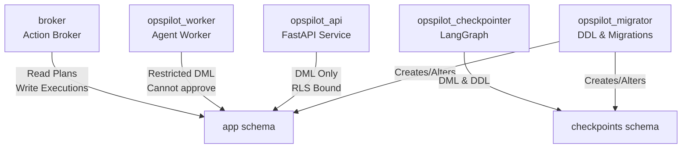

# OpsPilot PostgreSQL Data Model, Security & Invariant Report

This document records the definitive data architecture, database schema, security invariants, authorization matrix, REST API endpoints, and operational limits implemented for OpsPilot in Feature 4.

---

## 1. Schema Architecture Overview

OpsPilot uses PostgreSQL 17 partitioned into two isolated logical schemas:
1. **`app`**: Stores all multi-tenant operational data, incident timelines, diagnostic hypotheses, quarantined observations, cryptographically hashed action plans, human reviewer approvals, execution records, audit events, and the state machine transition graph.
2. **`checkpoints`**: Dedicated schema provisioned exclusively for LangGraph PostgreSQL state persistence (`PostgresSaver` / checkpointer). Tables in `app` never reference tables in `checkpoints`, preserving strict isolation between business domain aggregates and low-level agent graph execution traces.

### Entity-Relationship Architecture

---

## 2. Final Relational Schema (`app` Schema)

Primary keys use UUIDs (UUIDv4/UUIDv7) with `gen_random_uuid()` defaults across domain entities, with the exception of `app.run_events` which uses a 64-bit auto-incrementing identity (`BIGINT GENERATED ALWAYS AS IDENTITY`) combined with run-scoped sequence `seq` for monotonic ordering. All timestamps are stored as `TIMESTAMPTZ` normalized to UTC.

### 2.1 Multi-Tenancy & Authentication Tables

#### `app.tenants`
Logical tenant boundary isolating all enterprise customers and operational partitions.

| Column | Type | Constraints | Description |
| :--- | :--- | :--- | :--- |
| `id` | `UUID` | `PRIMARY KEY DEFAULT gen_random_uuid()` | Unique tenant identifier. |
| `name` | `VARCHAR(255)` | `NOT NULL` | Organization name. |
| `slug` | `VARCHAR(64)` | `NOT NULL UNIQUE` | URL-safe tenant identifier. |
| `created_at` | `TIMESTAMPTZ` | `NOT NULL DEFAULT clock_timestamp()` | Creation timestamp. |
| `updated_at` | `TIMESTAMPTZ` | `NOT NULL DEFAULT clock_timestamp()` | Last update timestamp. |

#### `app.users`
Operators, reviewers, and administrators with role-based access control.

| Column | Type | Constraints | Description |
| :--- | :--- | :--- | :--- |
| `id` | `UUID` | `PRIMARY KEY DEFAULT gen_random_uuid()` | Unique user identifier. |
| `tenant_id` | `UUID` | `NOT NULL REFERENCES app.tenants(id) ON DELETE CASCADE` | Multi-tenant scoping foreign key. |
| `email` | `VARCHAR(255)` | `NOT NULL` | User email address. |
| `role` | `VARCHAR(32)` | `NOT NULL CHECK (role IN ('viewer', 'reviewer', 'admin'))` | RBAC permission level. |
| `password_hash` | `VARCHAR(255)` | `NOT NULL` | Argon2id cryptographic password hash. |
| `created_at` | `TIMESTAMPTZ` | `NOT NULL DEFAULT clock_timestamp()` | Account creation timestamp. |
| `updated_at` | `TIMESTAMPTZ` | `NOT NULL DEFAULT clock_timestamp()` | Profile modification timestamp. |

*Table Constraints:* `UNIQUE (tenant_id, email)`

#### `app.sessions`
Opaque random bearer sessions issued via HttpOnly, SameSite=Strict cookies.

| Column | Type | Constraints | Description |
| :--- | :--- | :--- | :--- |
| `token_hash` | `VARCHAR(64)` | `PRIMARY KEY` | SHA-256 hash of the 256-bit raw session token. |
| `user_id` | `UUID` | `NOT NULL REFERENCES app.users(id) ON DELETE CASCADE` | Authenticated principal reference. |
| `tenant_id` | `UUID` | `NOT NULL REFERENCES app.tenants(id) ON DELETE CASCADE` | Redundant tenant boundary for RLS verification. |
| `expires_at` | `TIMESTAMPTZ` | `NOT NULL` | Session expiry deadline. |
| `created_at` | `TIMESTAMPTZ` | `NOT NULL DEFAULT clock_timestamp()` | Session issuance timestamp. |
| `revoked_at` | `TIMESTAMPTZ` | `NULL` | Explicit logout or revocation timestamp. |

---

### 2.2 Incidents & Run State Machine Tables

#### `app.incidents`
Alert envelope or benchmark case reference triggering an investigation.

| Column | Type | Constraints | Description |
| :--- | :--- | :--- | :--- |
| `id` | `UUID` | `PRIMARY KEY DEFAULT gen_random_uuid()` | Unique incident identifier. |
| `tenant_id` | `UUID` | `NOT NULL REFERENCES app.tenants(id) ON DELETE CASCADE` | Multi-tenant boundary. |
| `alert_id` | `VARCHAR(64)` | `NOT NULL` | External or synthetic alert event ID. |
| `source` | `VARCHAR(32)` | `NOT NULL CHECK (source IN ('alert', 'seeded_case'))` | Ingestion source. |
| `service` | `VARCHAR(64)` | `NOT NULL CHECK (service IN ('gateway', 'orders', 'inventory'))` | Target microservice name. |
| `severity` | `VARCHAR(32)` | `NOT NULL CHECK (severity IN ('LOW', 'MEDIUM', 'HIGH', 'CRITICAL'))` | Incident severity rating. |
| `alert_payload`| `JSONB` | `NOT NULL CHECK (jsonb_typeof(alert_payload) = 'object')` | Validated alert schema data. |
| `opened_at` | `TIMESTAMPTZ` | `NOT NULL` | Detection timestamp. |
| `closed_at` | `TIMESTAMPTZ` | `NULL` | Resolution timestamp. |
| `status_summary`| `VARCHAR(64)`| `NOT NULL DEFAULT 'open'` | Incident status summary. |
| `created_at` | `TIMESTAMPTZ` | `NOT NULL DEFAULT clock_timestamp()` | Creation timestamp. |

#### `app.runs`
Agent investigation execution lifecycle governed by optimistic concurrency and trigger-enforced transitions.

| Column | Type | Constraints | Description |
| :--- | :--- | :--- | :--- |
| `id` | `UUID` | `PRIMARY KEY DEFAULT gen_random_uuid()` | Investigation run identifier. |
| `tenant_id` | `UUID` | `NOT NULL REFERENCES app.tenants(id) ON DELETE CASCADE` | Multi-tenant boundary. |
| `incident_id` | `UUID` | `NOT NULL REFERENCES app.incidents(id) ON DELETE CASCADE` | Parent incident reference. |
| `case_id` | `VARCHAR(128)` | `NULL` | Optional evaluation scenario identifier (`S1`–`S5`). |
| `idempotency_key`| `VARCHAR(255)`| `NULL` | Client-provided deduplication key. |
| `status` | `VARCHAR(32)` | `NOT NULL CHECK (status IN ('queued', 'investigating', 'needs_review', 'approved', 'executing', 'verifying', 'completed', 'escalated', 'failed'))` | State machine status. |
| `version` | `INTEGER` | `NOT NULL DEFAULT 1` | Optimistic locking version (auto-incremented on transition). |
| `remaining_calls`| `INTEGER` | `NOT NULL DEFAULT 8 CHECK (remaining_calls >= 0)` | Remaining tool call quota budget. |
| `max_calls` | `INTEGER` | `NOT NULL DEFAULT 8 CHECK (max_calls > 0 AND max_calls <= 20)` | Maximum allowed tool invocations. |
| `last_error` | `JSONB` | `NULL CHECK (last_error IS NULL OR jsonb_typeof(last_error) = 'object')` | Structured error diagnostic. |
| `created_at` | `TIMESTAMPTZ` | `NOT NULL DEFAULT clock_timestamp()` | Run initiation timestamp. |
| `updated_at` | `TIMESTAMPTZ` | `NOT NULL DEFAULT clock_timestamp()` | Last status transition timestamp. |
| `finished_at`| `TIMESTAMPTZ` | `NULL` | Terminal state timestamp. |

*Table Constraints:* `UNIQUE (tenant_id, idempotency_key)`

#### `app.allowed_transitions`
Seed-driven state machine transition whitelist referenced by `trg_runs_enforce_transition`.

| Column | Type | Constraints | Description |
| :--- | :--- | :--- | :--- |
| `from_status` | `VARCHAR(32)` | `NOT NULL` | Origin run status. |
| `to_status` | `VARCHAR(32)` | `NOT NULL` | Destination run status. |
| `description` | `TEXT` | `NOT NULL` | Operational meaning of transition. |

*Primary Key:* `(from_status, to_status)`

*Permitted Transition Graph:*
- `queued -> investigating`
- `investigating -> needs_review`
- `needs_review -> approved`
- `approved -> executing`
- `executing -> verifying`
- `verifying -> completed`
- `investigating -> escalated` (budget exhaustion, unsolvable fault, or manual cancel)
- `needs_review -> escalated` (rejection or cancellation)
- `executing -> escalated` (broker or execution failure)
- `verifying -> escalated` (recovery verification failure)
- `queued -> failed` (initialization error)
- `investigating -> failed` (fatal unhandled exception)
- `executing -> failed` (fatal unhandled broker fault)

#### `app.run_events`
Strictly append-only timeline audit log for SSE streaming, catchup, and evaluation.

| Column | Type | Constraints | Description |
| :--- | :--- | :--- | :--- |
| `id` | `BIGINT` | `PRIMARY KEY GENERATED ALWAYS AS IDENTITY` | Monotonic global sequence identifier. |
| `run_id` | `UUID` | `NOT NULL REFERENCES app.runs(id) ON DELETE CASCADE` | Associated run identifier. |
| `tenant_id` | `UUID` | `NOT NULL REFERENCES app.tenants(id) ON DELETE CASCADE` | Multi-tenant boundary. |
| `seq` | `INTEGER` | `NOT NULL` | Monotonic run-scoped event sequence (1, 2, 3...). |
| `type` | `VARCHAR(64)` | `NOT NULL` | Event classifier (`run_created`, `status_changed`, `tool_call`...). |
| `actor` | `VARCHAR(64)` | `NOT NULL` | Event initiator (`agent`, `human_reviewer`, `system`, `broker`). |
| `payload` | `JSONB` | `NOT NULL DEFAULT '{}'::jsonb CHECK (jsonb_typeof(payload) = 'object')` | Redacted and sanitized event details. |
| `created_at` | `TIMESTAMPTZ` | `NOT NULL DEFAULT clock_timestamp()` | Event generation timestamp. |

*Table Constraints:* `UNIQUE (run_id, seq)`

---

### 2.3 Diagnostic, Evidence & Action Tables

#### `app.observations`
Append-only evidence store recording raw and summarized tool execution results.

| Column | Type | Constraints | Description |
| :--- | :--- | :--- | :--- |
| `id` | `UUID` | `PRIMARY KEY DEFAULT gen_random_uuid()` | Observation identifier. |
| `evidence_id`| `VARCHAR(64)` | `NOT NULL` | Tool-generated stable evidence ID (`ev_<sha256_12>`). |
| `run_id` | `UUID` | `NOT NULL REFERENCES app.runs(id) ON DELETE CASCADE` | Associated run. |
| `tenant_id` | `UUID` | `NOT NULL REFERENCES app.tenants(id) ON DELETE CASCADE` | Multi-tenant boundary. |
| `tool` | `VARCHAR(64)` | `NOT NULL` | Tool identifier (`get_metrics`, `search_logs`...). |
| `source_id` | `VARCHAR(255)` | `NOT NULL` | Source URI (`prometheus://...`, `loki://...`). |
| `captured_at`| `TIMESTAMPTZ` | `NOT NULL` | Telemetry observation timestamp. |
| `window_start`| `TIMESTAMPTZ`| `NOT NULL` | Telemetry query time window start. |
| `window_end` | `TIMESTAMPTZ` | `NOT NULL` | Telemetry query time window end. |
| `args` | `JSONB` | `NOT NULL CHECK (jsonb_typeof(args) = 'object')` | Normalized query arguments. |
| `summary` | `TEXT` | `NOT NULL` | Human-readable quarantined summary. |
| `payload` | `JSONB` | `NULL CHECK (payload IS NULL OR jsonb_typeof(payload) IN ('object', 'array'))` | Quarantined JSON payload (capped at 64 KB). |
| `payload_ref`| `VARCHAR(512)`| `NULL` | File path reference to artifacts store for payloads $> 64$ KB. |
| `source_version`| `VARCHAR(64)`| `NOT NULL` | Telemetry or service version identifier. |
| `content_hash`| `VARCHAR(64)`| `NOT NULL` | SHA-256 hash of canonical JSON `(payload or payload_ref)`. |
| `created_at` | `TIMESTAMPTZ` | `NOT NULL DEFAULT clock_timestamp()` | Ingestion timestamp. |

*Table Constraints:*
- `UNIQUE (run_id, evidence_id)`
- `CHECK (payload IS NOT NULL OR payload_ref IS NOT NULL)`

#### `app.hypotheses`
Working theories tracked by the agent during investigation.

| Column | Type | Constraints | Description |
| :--- | :--- | :--- | :--- |
| `id` | `UUID` | `PRIMARY KEY DEFAULT gen_random_uuid()` | Hypothesis identifier. |
| `run_id` | `UUID` | `NOT NULL REFERENCES app.runs(id) ON DELETE CASCADE` | Associated run. |
| `tenant_id` | `UUID` | `NOT NULL REFERENCES app.tenants(id) ON DELETE CASCADE` | Multi-tenant boundary. |
| `statement` | `TEXT` | `NOT NULL` | Natural language diagnostic statement. |
| `category` | `VARCHAR(64)` | `NOT NULL` | Failure family (`bad_deploy`, `dependency_outage`...). |
| `mechanism` | `VARCHAR(64)` | `NOT NULL` | Failure mechanism (`pool_exhaustion`...). |
| `service` | `VARCHAR(64)` | `NOT NULL CHECK (service IN ('gateway', 'orders', 'inventory'))` | Target microservice. |
| `status` | `VARCHAR(32)` | `NOT NULL CHECK (status IN ('formulated', 'supported', 'refuted', 'abandoned'))` | Verification state. |
| `supporting_evidence_ids`| `TEXT[]`| `NOT NULL DEFAULT '{}'` | Supporting `evidence_id` array. |
| `refuting_evidence_ids`| `TEXT[]`| `NOT NULL DEFAULT '{}'` | Refuting `evidence_id` array. |
| `confidence` | `NUMERIC(3,2)` | `NOT NULL CHECK (confidence >= 0.0 AND confidence <= 1.0)` | Probability confidence score. |
| `created_at` | `TIMESTAMPTZ` | `NOT NULL DEFAULT clock_timestamp()` | Formulation timestamp. |
| `updated_at` | `TIMESTAMPTZ` | `NOT NULL DEFAULT clock_timestamp()` | Status update timestamp. |

#### `app.diagnoses`
Concluded root cause determination generated by the agent prior to plan proposal.

| Column | Type | Constraints | Description |
| :--- | :--- | :--- | :--- |
| `id` | `UUID` | `PRIMARY KEY DEFAULT gen_random_uuid()` | Diagnosis identifier. |
| `run_id` | `UUID` | `NOT NULL UNIQUE REFERENCES app.runs(id) ON DELETE CASCADE` | Associated run (at most 1 per run). |
| `tenant_id` | `UUID` | `NOT NULL REFERENCES app.tenants(id) ON DELETE CASCADE` | Multi-tenant boundary. |
| `root_cause_service`| `VARCHAR(64)`| `NOT NULL CHECK (root_cause_service IN ('gateway', 'orders', 'inventory'))` | Identified faulty service. |
| `root_cause_category`| `VARCHAR(64)`| `NOT NULL` | Root cause failure family. |
| `mechanism` | `VARCHAR(64)` | `NOT NULL` | Specific failure mechanism. |
| `culprit_deploy_id`| `VARCHAR(64)`| `NULL` | Optional faulty deployment identifier. |
| `evidence_ids`| `TEXT[]` | `NOT NULL DEFAULT '{}'` | Supporting `evidence_id` list. |
| `confidence` | `NUMERIC(3,2)` | `NOT NULL CHECK (confidence >= 0.0 AND confidence <= 1.0)` | Diagnostic confidence score. |
| `created_at` | `TIMESTAMPTZ` | `NOT NULL DEFAULT clock_timestamp()` | Diagnosis finalization timestamp. |

#### `app.action_plans`
Immutable recovery plans proposed by the agent, protected by cryptographic plan hash triggers.

| Column | Type | Constraints | Description |
| :--- | :--- | :--- | :--- |
| `id` | `UUID` | `PRIMARY KEY DEFAULT gen_random_uuid()` | Plan identifier. |
| `run_id` | `UUID` | `NOT NULL REFERENCES app.runs(id) ON DELETE CASCADE` | Associated run. |
| `tenant_id` | `UUID` | `NOT NULL REFERENCES app.tenants(id) ON DELETE CASCADE` | Multi-tenant boundary. |
| `action` | `VARCHAR(32)` | `NOT NULL CHECK (action IN ('rollback_service', 'restart_service', 'no_action', 'escalate'))` | Permitted remediation action. |
| `service` | `VARCHAR(64)` | `NULL CHECK (service IS NULL OR service IN ('gateway', 'orders', 'inventory'))` | Target service (required for rollback/restart). |
| `expected_version`| `VARCHAR(64)`| `NULL` | Target version for rollback (e.g., `v1.2.0`). |
| `rationale_evidence_ids`| `TEXT[]`| `NOT NULL DEFAULT '{}'` | Required supporting evidence IDs. |
| `rollback_route`| `VARCHAR(64)`| `NULL` | Optional recovery route name. |
| `plan_hash` | `VARCHAR(64)` | `NOT NULL` | SHA-256 of canonical JSON plan fields. |
| `status` | `VARCHAR(32)` | `NOT NULL DEFAULT 'proposed' CHECK (status IN ('proposed', 'approved', 'rejected', 'executed', 'expired'))` | Plan review state. |
| `notes` | `TEXT` | `NULL` | Agent explanation and justification. |
| `expires_at` | `TIMESTAMPTZ` | `NOT NULL` | Plan validity deadline. |
| `created_at` | `TIMESTAMPTZ` | `NOT NULL DEFAULT clock_timestamp()` | Plan proposal timestamp. |
| `updated_at` | `TIMESTAMPTZ` | `NOT NULL DEFAULT clock_timestamp()` | State change timestamp. |

*Table Constraints:*
- `UNIQUE (plan_hash)`
- `CHECK ((action IN ('rollback_service', 'restart_service') AND service IS NOT NULL) OR (action IN ('no_action', 'escalate') AND service IS NULL))`

#### `app.approvals`
Audit record of human reviewer cryptographic approval or rejection decisions.

| Column | Type | Constraints | Description |
| :--- | :--- | :--- | :--- |
| `id` | `UUID` | `PRIMARY KEY DEFAULT gen_random_uuid()` | Approval decision identifier. |
| `plan_id` | `UUID` | `NOT NULL REFERENCES app.action_plans(id) ON DELETE CASCADE` | Target action plan. |
| `tenant_id` | `UUID` | `NOT NULL REFERENCES app.tenants(id) ON DELETE CASCADE` | Multi-tenant boundary. |
| `reviewer_id`| `UUID` | `NOT NULL REFERENCES app.users(id) ON DELETE CASCADE` | Human reviewer identity. |
| `decision` | `VARCHAR(32)` | `NOT NULL CHECK (decision IN ('approved', 'rejected'))` | Human decision verdict. |
| `submitted_plan_hash`| `VARCHAR(64)`| `NOT NULL` | Cryptographic plan hash submitted by reviewer UI. |
| `reason` | `TEXT` | `NOT NULL` | Mandatory human justification rationale. |
| `decided_at` | `TIMESTAMPTZ` | `NOT NULL DEFAULT clock_timestamp()` | Decision timestamp. |

*Table Constraints:* `UNIQUE (plan_id, reviewer_id)`

#### `app.action_executions`
Audit log of physical executions performed exclusively by the broker.

| Column | Type | Constraints | Description |
| :--- | :--- | :--- | :--- |
| `id` | `UUID` | `PRIMARY KEY DEFAULT gen_random_uuid()` | Execution identifier. |
| `plan_id` | `UUID` | `NOT NULL REFERENCES app.action_plans(id) ON DELETE CASCADE` | Parent approved action plan. |
| `tenant_id` | `UUID` | `NOT NULL REFERENCES app.tenants(id) ON DELETE CASCADE` | Multi-tenant boundary. |
| `action_key` | `VARCHAR(255)` | `NOT NULL UNIQUE` | Deterministic broker deduplication key. |
| `target_service`| `VARCHAR(64)`| `NULL` | Executed target service. |
| `action_type` | `VARCHAR(32)` | `NOT NULL CHECK (action_type IN ('rollback_service', 'restart_service', 'no_action', 'escalate'))` | Executed action type. |
| `status` | `VARCHAR(32)` | `NOT NULL CHECK (status IN ('started', 'succeeded', 'failed'))` | Execution state. |
| `stdout` | `TEXT` | `NULL` | Broker execution standard output. |
| `stderr` | `TEXT` | `NULL` | Broker execution standard error. |
| `started_at` | `TIMESTAMPTZ` | `NOT NULL DEFAULT clock_timestamp()` | Broker invocation timestamp. |
| `finished_at`| `TIMESTAMPTZ` | `NULL` | Execution completion timestamp. |

---

## 3. Constraint & Invariant Enforcement Matrix (Database vs. Application)

To guarantee that bugs in LLM code or API route handlers cannot violate system invariants, enforcement is stratified between Postgres triggers/constraints and application-level service guards.

| Invariant / Rule | Layer | Mechanism | Failure Behavior |
| :--- | :--- | :--- | :--- |
| **Tenant Isolation** | PostgreSQL | Row-Level Security `USING (tenant_id = current_setting('app.tenant_id')::uuid)` with `FORCE ROW LEVEL SECURITY` | Unmatched rows invisible; cross-tenant updates/deletes return 0 rows; cross-tenant inserts fail with policy violation. |
| **Tenant Context Binding** | Application | `TenantContext` injected via session cookies; executed via `SET LOCAL app.tenant_id = :tenant_id` inside explicit transactions | Missing session fails authentication with 401; unauthenticated queries fail RLS cast. |
| **Plan Immutability** | PostgreSQL | Trigger `trg_enforce_plan_immutability` on `app.action_plans` | `UPDATE` modifying `action`, `service`, `expected_version`, `rationale_evidence_ids`, `rollback_route`, `plan_hash`, `run_id`, or `tenant_id` raises SQL exception `Action plans are immutable`. |
| **Plan Hash Verification** | PostgreSQL | Trigger `trg_verify_plan_hash` on `app.action_plans` | Recomputes SHA-256 over canonical JSON string on insert; mismatch raises SQL exception `Plan hash mismatch on insert`. |
| **Canonical Plan Hashing** | Application | `compute_plan_hash()` in `apps/api/models/hashing.py` | Canonical JSON: keys sorted, compact separators `(',', ':')`, UTC timestamps, deterministic array order. |
| **State Machine Transition Enforcement** | PostgreSQL | Trigger `trg_runs_enforce_transition` against `app.allowed_transitions` | Illegal `(OLD.status, NEW.status)` raises SQL exception `Illegal run status transition from "X" to "Y"`. Auto-increments `version` and stamps `finished_at` on terminal status. |
| **State Machine Validation (Fail-Fast)** | Application | `RunService.transition()` with `ALLOWED_TRANSITIONS` lookup | Pre-validates transitions in Python domain code, raising typed `IllegalTransitionError` (maps to HTTP 400). |
| **Optimistic Concurrency Control** | Application & DB | `UPDATE app.runs ... WHERE id = :id AND version = :expected_version` | Zero affected rows raises `ConcurrentModificationError` (maps to HTTP 409). |
| **Append-Only Timeline Audit** | PostgreSQL | Trigger `trg_run_events_append_only` on `app.run_events` | `UPDATE` or `DELETE` raises SQL exception `Table "run_events" is strictly append-only`. |
| **Append-Only Evidence Audit** | PostgreSQL | Trigger `trg_observations_append_only` on `app.observations` | `UPDATE` or `DELETE` raises SQL exception `Table "observations" is strictly append-only`. |
| **Immutable Human Approvals** | PostgreSQL | Trigger `trg_approvals_no_delete` on `app.approvals` | `DELETE` raises SQL exception `Deletions from "approvals" are strictly prohibited`. |
| **Immutable Action Executions** | PostgreSQL | Trigger `trg_action_executions_no_delete` on `app.action_executions` | `DELETE` raises SQL exception `Deletions from "action_executions" are strictly prohibited`. |
| **Action Service Consistency** | PostgreSQL | CHECK constraint `chk_action_plans_service_consistency` | Rollback/restart missing `service`, or no_action/escalate with `service` fails with SQL CheckViolation. |
| **Unique Action Execution Key** | PostgreSQL | UNIQUE constraint on `app.action_executions(action_key)` | Duplicate broker action execution raises SQL UniqueViolation. |
| **Monotonic Event Sequence** | PostgreSQL | UNIQUE constraint on `app.run_events(run_id, seq)` | Reused sequence number raises SQL UniqueViolation. |
| **Tool Budget Accounting** | PostgreSQL & App | `remaining_calls >= 0` CHECK constraint and `decrement_calls()` | Decrementing below 0 fails with `BudgetExhaustedError` (maps to HTTP 400). |
| **Oversized Evidence Handling** | Application | `PostgresEvidenceStore` with 64 KB inline cap | Payloads $\le 64$ KB stored inline in `payload`; payloads $> 64$ KB saved to artifacts disk with `payload_ref` and summary. |
| **Evidence Determinism Conflict** | Application | `PostgresEvidenceStore.put()` with SHA-256 comparison | Re-inserting existing `(run_id, evidence_id)` with different `content_hash` raises `EvidenceConflictError`. |

---

## 4. Row-Level Security (RLS) Policy Specifications

Row-Level Security is enabled and enforced with `FORCE ROW LEVEL SECURITY` across all tenant-scoped tables in schema `app`. This ensures table owners (such as developer credentials) are subject to tenant isolation policies. Only the migration maintenance role (`opspilot_migrator`) is exempted.

### RLS Policy Matrix

| Table Name | Policy Name | Permitted Commands | Policy Expression |
| :--- | :--- | :--- | :--- |
| `app.users` | `tenant_isolation_policy` | ALL | `USING (tenant_id = current_setting('app.tenant_id')::uuid)` |
| `app.sessions` | `tenant_isolation_policy` | ALL | `USING (tenant_id = current_setting('app.tenant_id')::uuid)` |
| `app.incidents` | `tenant_isolation_policy` | ALL | `USING (tenant_id = current_setting('app.tenant_id')::uuid)` |
| `app.runs` | `tenant_isolation_policy` | ALL | `USING (tenant_id = current_setting('app.tenant_id')::uuid)` |
| `app.run_events` | `tenant_isolation_policy` | ALL | `USING (tenant_id = current_setting('app.tenant_id')::uuid)` |
| `app.hypotheses` | `tenant_isolation_policy` | ALL | `USING (tenant_id = current_setting('app.tenant_id')::uuid)` |
| `app.diagnoses` | `tenant_isolation_policy` | ALL | `USING (tenant_id = current_setting('app.tenant_id')::uuid)` |
| `app.observations`| `tenant_isolation_policy` | ALL | `USING (tenant_id = current_setting('app.tenant_id')::uuid)` |
| `app.action_plans`| `tenant_isolation_policy` | ALL | `USING (tenant_id = current_setting('app.tenant_id')::uuid)` |
| `app.approvals` | `tenant_isolation_policy` | ALL | `USING (tenant_id = current_setting('app.tenant_id')::uuid)` |
| `app.action_executions`| `tenant_isolation_policy` | ALL | `USING (tenant_id = current_setting('app.tenant_id')::uuid)` |

*Global Configuration:*
- All tables execute: `ALTER TABLE app.<table_name> ENABLE ROW LEVEL SECURITY;`
- All tables execute: `ALTER TABLE app.<table_name> FORCE ROW LEVEL SECURITY;`
- Connection configuration: `SET LOCAL app.tenant_id = '<uuid>';` executed per transaction.

---

## 5. PostgreSQL Roles & Privilege Matrix

OpsPilot defines 5 dedicated PostgreSQL roles with least-privilege boundaries:

| Role Name | Purpose | Schemas Granted | Allowed Table Privileges | Restricted Privileges |
| :--- | :--- | :--- | :--- | :--- |
| `opspilot_migrator` | Schema migrations and DDL maintenance | `app`, `checkpoints`, `public` | `ALL PRIVILEGES` on all tables, sequences, functions. `BYPASSRLS` attribute enabled. | Cannot be used for customer-facing runtime queries. |
| `opspilot_api` | REST API runtime service | `app` | `SELECT, INSERT, UPDATE, DELETE` on all `app` tables; `USAGE, SELECT` on all sequences. | `NO DDL`. Bound strictly by RLS. No access to `checkpoints` schema. |
| `opspilot_worker` | Background agent worker tasks | `app` | `SELECT, INSERT, UPDATE` on `runs, run_events, hypotheses, observations, action_plans`. | `NO DDL`. Cannot `INSERT` or `UPDATE` on `approvals`. Cannot access `checkpoints`. |
| `opspilot_checkpointer` | LangGraph agent graph checkpoints | `checkpoints` | `ALL PRIVILEGES` on schema `checkpoints`. | Zero access to schema `app`. Cannot read business data, credentials, or audit logs. |
| `broker` | Physical action execution worker (Feature 9) | `app` | `SELECT` on `action_plans`; `SELECT, INSERT, UPDATE` on `action_executions`. | Zero access to user sessions, credentials, hypotheses, or raw evidence. Cannot insert plans or approvals. |

---

## 6. REST API Endpoint & Role Enforcement Matrix

All API endpoints require authentication via session cookies or internal service principal headers. Identities and tenant IDs are extracted strictly from server-side session tokens, never from request bodies, query parameters, or LLM output. State-changing requests (`POST`, `PUT`, `DELETE`) require CSRF validation (`X-Requested-With: XMLHttpRequest`).

| Endpoint | Method | Required Role | Request Body | Success Response | Error Envelopes | Description |
| :--- | :--- | :--- | :--- | :--- | :--- | :--- |
| `/auth/login` | `POST` | Public | `LoginRequest` (`email`, `password`) | `200 OK`: `UserResponse` + Set HttpOnly Cookie | 400 (Malformed), 401 (Bad Credentials), 429 (Rate Limit) | Authenticates user using Argon2id; issues session. |
| `/auth/logout` | `POST` | Any Authenticated | None | `200 OK`: `{"status":"logged_out"}` | 401 (Unauthenticated) | Revokes active session token in DB and clears cookie. |
| `/auth/me` | `GET` | Any Authenticated | None | `200 OK`: `UserResponse` (`id`, `tenant_id`, `role`, `email`) | 401 (Unauthenticated) | Returns current session principal details. |
| `/incidents` | `POST` | `reviewer`, `admin` | `IncidentCreateRequest` (`alert` or `case_id`) | `201 Created`: `IncidentResponse` | 400 (Validation), 401, 403 (Viewer), 409 (Idempotency Conflict) | Ingests alert and creates new incident. Supports `Idempotency-Key`. |
| `/runs` | `POST` | `reviewer`, `admin` | `RunCreateRequest` (`incident_id`, `max_calls?`) | `201 Created`: `RunResponse` (`status="queued"`) | 400 (Bad incident), 401, 403 (Viewer), 409 (Conflict), 429 (Rate Limit) | Spawns investigation run. Requires `Idempotency-Key`. |
| `/runs` | `GET` | `viewer`, `reviewer`, `admin` | None (Query: `status`, `incident_id`, `limit`, `cursor`) | `200 OK`: `PaginatedRunsResponse` (`items`, `next_cursor`, `has_more`) | 401, 404 | Cursor-paginated listing of runs within tenant scope. |
| `/runs/{id}` | `GET` | `viewer`, `reviewer`, `admin` | None | `200 OK`: `RunDetailResponse` (status, version, hypotheses, diagnosis, plan) | 401, 404 (No existence leak) | Returns detailed run aggregates. Cross-tenant returns 404. |
| `/runs/{id}/cancel` | `POST` | `reviewer`, `admin` | None | `200 OK`: `RunResponse` (`status="escalated"`) | 400 (Terminal run), 401, 403 (Viewer), 404 | Cancels non-terminal run, moving status to `escalated`. |
| `/runs/{id}/events` | `GET` (JSON) | `viewer`, `reviewer`, `admin` | None (Query: `after_seq`) | `200 OK`: `RunEventsListResponse` (`items`, `last_seq`, `has_more`) | 401, 404 | Polling mode returning ordered run events after `after_seq`. |
| `/runs/{id}/events` | `GET` (SSE) | `viewer`, `reviewer`, `admin` | None (`Accept: text/event-stream`, `Last-Event-ID`) | `200 OK` (Stream: `text/event-stream`) | 401, 404 | Real-time Server-Sent Events stream with 15s heartbeats. |
| `/runs/{id}/evidence`| `GET` | `viewer`, `reviewer`, `admin` | None | `200 OK`: `list[ObservationResponse]` | 401, 404 | Returns all quarantined observations recorded for run. |
| `/runs/{id}/evidence/{evidence_id}` | `GET` | `viewer`, `reviewer`, `admin` | None | `200 OK`: `ObservationResponse` | 401, 404 | Returns specific observation payload and summary. |
| `/plans/{id}` | `GET` | `viewer`, `reviewer`, `admin` | None | `200 OK`: `ActionPlanResponse` | 401, 404 | Read-only view of proposed recovery plan for review UI. |
| `/plans/{id}/decisions` | `POST` | `reviewer`, `admin` | `PlanDecisionRequest` (`decision`, `submitted_plan_hash`, `reason`) | `501 Not Implemented` (Reserved for Feature 8) | 400, 401, 403 (Viewer), 404, 501 | Cryptographic approval decision route endpoint stub. |

---

## 7. Known Limits, Quotas & Operational Boundaries

1. **Tool Invocation Budget**: Hard cap of `max_calls = 8` (configurable between 1 and 20). Enforced via atomic database decrement and `CHECK (remaining_calls >= 0)`.
2. **Payload Size Caps**: Observations store JSON payloads inline up to 64 KB. Payloads exceeding 64 KB are persisted to artifacts disk with SHA-256 validation, storing only a summary and `payload_ref` in Postgres.
3. **SSE Connection Caps**: Server-Sent Events connections cap continuous streaming duration at 300 seconds (configurable) to prevent resource leakage, emitting periodic heartbeat comments every 15 seconds.
4. **Rate Limiting**:
   - Authentication endpoint (`/auth/login`): 10 login attempts per minute per IP address.
   - Run creation endpoint (`/runs`): 300 run creations per minute per tenant.
5. **Connection Pools**: Default application pool size is 20 connections with up to 10 overflow connections.

---

## 8. Evolution & Deviations from `data_model.md`

During implementation and rigorous invariant testing, the following refinements were introduced relative to the preliminary `docs/data_model.md` draft:

1. **`app.allowed_transitions` Lookup Table**:
   - *Draft*: Transition validity was initially envisioned as hardcoded application logic or static triggers.
   - *Final Implementation*: Seeded into a dedicated table `app.allowed_transitions`. The PostgreSQL trigger `trg_runs_enforce_transition` queries this table dynamically, ensuring state transitions are guaranteed by the database itself.
2. **Primary Key Typing (`BIGINT` vs `UUID` on `run_events`)**:
   - *Draft*: `docs/data_model.md` proposed UUID primary keys across all tables.
   - *Final Implementation*: `app.run_events.id` uses `BIGINT GENERATED ALWAYS AS IDENTITY`. Event sequencing requires strict global and run-scoped ordering (`seq`). Using `BIGINT` for event IDs enables high-performance SSE indexing and monotonic event dispatch without UUID sorting overhead.
3. **Session Revocation (`revoked_at`)**:
   - *Draft*: Sessions were expired solely through timestamp deletion or expiration checks.
   - *Final Implementation*: Added `revoked_at TIMESTAMPTZ` column to `app.sessions` via migration `317a98a10987` to support instant, audit-verifiable session revocation on `POST /auth/logout`.
4. **Large Observation Storage (`payload_ref`)**:
   - *Draft*: All observation payloads were stored directly in `JSONB`.
   - *Final Implementation*: Added `payload_ref VARCHAR(512)` column via migration `33cfa0915ccc` with constraint `CHECK (payload IS NOT NULL OR payload_ref IS NOT NULL)` to guard against PostgreSQL row bloat on large telemetry traces.
5. **Terminal State Expansion (`failed` and cancellation)**:
   - *Draft*: Draft state machine lacked an explicit `failed` terminal state for unhandled infrastructure crashes and cancellation routes.
   - *Final Implementation*: Added `failed` status via migration `42a1b2c3d4e5` and cancellation routes via `41f48d91c101`, complete with auto-stamping of `finished_at = clock_timestamp()` inside the transition trigger.
6. **Canonical JSON Plan Hashing in PostgreSQL**:
   - *Draft*: Proposed calling a generic MD5/SHA256 function on serialized plan fields.
   - *Final Implementation*: The database trigger `trg_verify_plan_hash` explicitly mirrors Python's canonical JSON serialization: compact formatting (zero whitespace around separators), sorted rationale evidence arrays (`array_to_json(ARRAY(SELECT unnest(...) ORDER BY 1))`), and SHA-256 byte hashing, ensuring bit-for-bit parity with client and API hashes.
