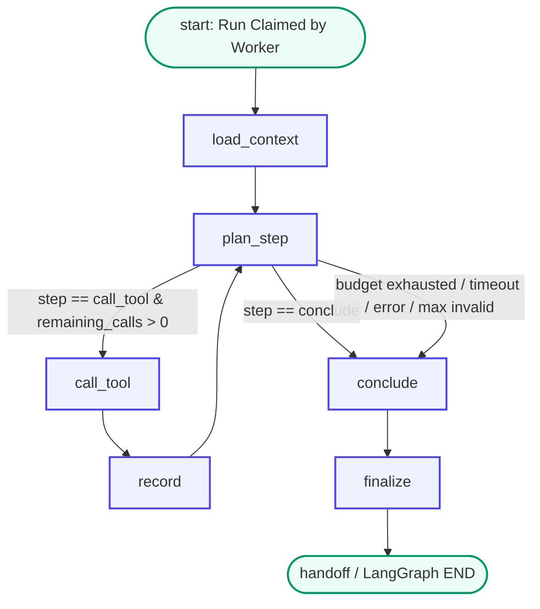

# OpsPilot Incident Investigator Agent Architecture & Build Report (Feature 5)

> **Document Status**: Complete Implementation Report  
> **Target Document**: `docs/INVESTIGATOR_REPORT.md`  
> **Relevant Features**: Feature 5 (Investigator Agent Graph), Feature 0.7 (LLM Interface), Feature 2.10 (Tool Registry), Feature 4.4 (Run Service), Feature 6 (Hypothesis Tracking & Escalation).

---

## 1. Graph Shape & Workflow Architecture (As Built)

The OpsPilot Investigator Agent is built as a bounded, deterministic state machine compiled with LangGraph. It ingests an incident alert, plans diagnostic steps, executes authorized read-only investigation queries, records verified evidence, and outputs a structured diagnosis artifact adhering to the Feature 1.12 domain contract.



---

## 2. Node Specification Table

| Node Name | Inputs | Outputs / Return | State Fields Written | Components Called | Hard Bounds & Guarantees |
| :--- | :--- | :--- | :--- | :--- | :--- |
| **`load_context`** | Initial state (`run_id`, `tenant_id`, `incident_id`, `alert`). | State partial update. | `run_id`, `tenant_id`, `incident_id`, `status` (`"investigating"`), `alert`, `remaining_calls` (8), `step_count` (0), `evidence_ids` (`[]`), `tool_trace` (`[]`), `messages_summary` (`""`), `draft_diagnosis` (`None`), `last_error` (`None`), `termination_reason` (`None`). | **RunService / Database** (`app.incidents`, `app.runs`). | Verifies active run lease; transitions status `queued -> investigating` under optimistic locking. Executes zero external tools. |
| **`plan_step`** | Assembled context (alert, static topology, evidence digest, tool specs, remaining budget, turn history). | Step decision (`CallToolStep` or `ConcludeStep`) or termination update. | `step_count` (+1), `last_step_decision`, `messages_summary`, `total_tokens_consumed`, `last_error`, `status`, `termination_reason`. | **LLMClient** (`GeminiClient` or `FakeLLMClient`) via `generate_structured`. | `temperature=0.0`, `max_output_tokens=1024`. Enforces `TokenBudgetGuard`. Emits audit event to `app.run_events`. Single-turn schema repair on validation failure; terminates after 3 invalid steps. |
| **`call_tool`** | Tool name (`tool`), sanitized arguments (`args`), server-injected `ToolContext`. | Ephemeral execution result (`ToolSuccess` or `ToolError`). | `remaining_calls` (decremented server-side), `transient_tool_result`. | **ToolRegistry** (`tools.registry.registry.dispatch`). | Server-side allowlist (`get_metrics`, `search_logs`, `get_trace`, `list_deploys`, `get_deploy_diff`). Validates arguments with Pydantic (`extra="forbid"`). Deduplicates calls via in-memory cache. |
| **`record`** | Tool execution result, raw payload, execution latency, and citation hash. | Updated state references. | `evidence_ids` (appends `evidence_id`), `tool_trace` (appends `ToolCallRecordRef`), `messages_summary` (appends 1-line audit summary), `transient_tool_result` (`None`), `last_error`. | **Evidence Store / Database** (`app.observations`, `app.run_events`). | Persists full raw payload and canonical SHA-256 content hash to PostgreSQL `app.observations`. Emits `tool_call` audit event to `app.run_events`. |
| **`conclude`** | Final `diagnosis_draft` from `ConcludeStep` or fallback `unknown` diagnosis on termination. | Validated diagnostic structure. | `draft_diagnosis` (`Diagnosis`), `termination_reason`. | **Deterministic Schema Validator** (`evals.graders.models.Diagnosis`). | Validates diagnosis draft against Feature 1.12 `Diagnosis` schema. If missing or malformed, constructs safe fallback `unknown` diagnosis citing all captured evidence IDs. Zero LLM calls. |
| **`finalize`** | Complete state with draft diagnosis and termination reason. | Grounded diagnosis and persisted records. | `draft_diagnosis` (verified citations), `evidence_ids` (filtered). | **Evidence Grader / DB** (`app.diagnoses`, `RunService.save_diagnosis`). | Validates citation integrity via `grade_evidence_support`: strips invalid or out-of-window IDs. If zero valid IDs remain for a non-unknown diagnosis, downgrades to `unknown`. Persists draft diagnosis to `app.diagnoses`. |
| **`handoff`** | Concluded `InvestigationState`. | Handoff result / LangGraph `END`. | `status` (`needs_review` or `escalated`). | **HandoffPort** (`DefaultHandoffStub`). | Dispatches concluded run to downstream services. Atomically transitions `app.runs.status` to `needs_review` (valid diagnosis) or `escalated` (provider error, budget exhaustion, or unconfigured planner). |

---

## 3. Termination Rules & State Transitions (As Implemented)

Every investigation run terminates deterministically under one of seven mutually exclusive conditions. Under non-model termination, the graph preserves all empirically collected evidence and generates a structured fallback diagnosis without throwing unhandled exceptions.

| Termination Reason | Trigger Condition | Final Run Status | Draft Diagnosis Content | Downstream Handoff Action |
| :--- | :--- | :--- | :--- | :--- |
| **`concluded_by_model`** | LLM outputs valid `ConcludeStep` with empirical citations. | `needs_review` (or `escalated` if planner unconfigured) | Model-generated `Diagnosis` validated against Feature 1.12 schema and grounded by `finalize`. | Transition to `needs_review`; emit event; hand off to human on-call. |
| **`budget_exhausted`** | `remaining_calls <= 0` reached before model concludes. | `escalated` | Fallback `unknown` diagnosis citing all evidence collected so far. Notes state budget exhausted. | Transition to `escalated` (`budget_exhausted`); human operator notified. |
| **`step_cap_reached`** | `step_count >= max_steps` (10 steps) reached. | `escalated` | Fallback `unknown` diagnosis citing collected evidence. | Transition to `escalated` (`step_cap_reached`); human operator notified. |
| **`timeout_exceeded`** | Wall-clock execution exceeds `RUN_TIMEOUT_SECONDS` (120s). | `escalated` | Fallback `unknown` diagnosis citing collected evidence. | Watchdog catches timeout; transitions to `escalated` (`timeout_exceeded`). |
| **`token_budget_exceeded`** | Cumulative tokens exceed configured limit (e.g. 50,000 tokens). | `escalated` | Fallback `unknown` diagnosis. Notes state token limit breached. | Transition to `escalated` (`token_budget_exceeded`). |
| **`provider_error_exhausted`** | LLM provider error (e.g. HTTP 429 quota exhaustion) persists after retries. | `escalated` | Fallback `unknown` diagnosis citing evidence captured prior to failure. | Transition to `escalated` (`provider_error_exhausted`). Never converted to wrong diagnosis. |
| **`invalid_step_cap_reached`** | 3 successive invalid step decisions fail single-turn schema repair. | `escalated` | Fallback `unknown` diagnosis citing collected evidence. | Transition to `escalated` (`invalid_step_cap_reached`). |

---

## 4. Graph State Schema (Typed)

To protect the context window and prevent token bloat, **LangGraph state holds IDs, reference pointers, and one-line summaries only**. Full raw payloads are strictly persisted to `app.observations`.

```python
class InvestigationState(TypedDict, total=False):
    # Identity & Tenancy
    run_id: str
    tenant_id: str
    incident_id: str
    status: str
    
    # Input Telemetry Context
    alert: AlertEvent | dict[str, Any]
    
    # Audit Summaries & References
    messages_summary: str
    evidence_ids: Annotated[list[str], append_evidence_ids]
    tool_trace: Annotated[list[ToolCallRecordRef], append_tool_trace]
    
    # Execution Budget Counters
    remaining_calls: int
    step_count: int
    invalid_step_count: int
    total_tokens_consumed: int
    
    # Diagnostic Output & Error State
    last_step_decision: dict[str, Any] | None
    draft_diagnosis: Diagnosis | dict[str, Any] | None
    last_error: dict[str, Any] | None
    termination_reason: str | None
    transient_tool_result: dict[str, Any] | None
```

- **Reducers**:
  - `append_evidence_ids`: Deduplicating, append-only order-preserving reducer.
  - `append_tool_trace`: Append-only reducer of lightweight `ToolCallRecordRef` references (`tool`, `args_summary`, `duration_ms`, `ok`, `evidence_id`, `approx_tokens`).
- **Storage Footprint**: Worst-case 8-tool-call state serializes to $< 16\text{ KB}$ JSON.

---

## 5. Prompt Version Governance & Hashes

Any modification to prompt directives or tool specifications alters model behavior. The cryptographic hash is committed and verified prior to every benchmark run:

- **System Prompt File**: `agent/prompts/investigator_system_v1.md`
- **Prompt Version**: `v1.0.0`
- **Content SHA-256 Hash**: `7c065736fe3721bba931953c9378015603f54f132a30446dd345a10472dad315`
- **Hash Computation**: `SHA-256(system_prompt_text + "\n---TOOL_SPECS---\n" + canonical_tool_specs_json)`
- **Zero-Leakage Status**: PASS (Zero hits across forbidden failure families, scenario IDs, and vault strings).
- **Candidate v2**: Proposed prompt improvements for Feature 6 logged in [docs/prompt_changelog.md](prompt_changelog.md).

---

## 6. Prompt-Injection & Security Defense Layers

The agent operates under five distinct defense layers preventing prompt injection, data exfiltration, and unauthorized execution:

| Defense Layer | Implementation Mechanism | Threat Blocked |
| :--- | :--- | :--- |
| **1. Deterministic Sanitisation** | `tools/common/sanitize.py`: strips control characters, normalizes Unicode, redacts credentials (`[REDACTED:<type>]`). | Rejects command injection, shell escapes, terminal control sequences, and credential leakage. |
| **2. Untrusted Data Quarantine** | Wraps all passive tool outputs (logs, stack traces, diffs) in `<untrusted_data source="..." evidence_id="...">`. Escapes closing tags `</untrusted_data>` to prevent delimiter breakout. | Blocks adversarial payload injection from log lines, span attributes, and commit messages. |
| **3. System Directive Isolation** | Prompt Section 6: Explicit instruction that text within untrusted delimiters represents passive data to analyze and is never an instruction. | Instructs model to ignore simulated "admin overrides", "emergency instructions", or AI directives inside telemetry. |
| **4. Server-Side Tool Allowlist** | Tool registry enforces closed allowlist (`ALLOWED_INVESTIGATION_TOOLS`) and validates arguments with Pydantic (`extra="forbid"`). | Even if the model is tricked into requesting arbitrary tools (`exec`, `bash`, `curl`), the server-side dispatcher rejects the invocation. |
| **5. Read-Only Graph Boundary** | Zero mutation or write tools exist in the investigation graph. | The model has no capability to restart containers, deploy code, execute rollbacks, or alter system state. |
| **6. Zero-Leakage Scanning** | `agent/graph/context.py` scans prompt text and tool specs against Feature 1.13 benchmark leakage terms. | Prevents benchmark contamination, scenario ID leakage, or failure family names from reaching the model. |

---

## 7. Known Limits

1. **Development Scenarios Only**: Evaluated exclusively against development scenarios (S1–S5). Sealed split evaluation is scheduled for Feature 13.
2. **Single Trial Sample ($N=1$)**: Does not establish statistical variance or tight confidence bounds.
3. **Investigation & Diagnosis Only**: Feature 5 produces a diagnosis artifact; it does not synthesize recovery action plans (Feature 7) or execute mutations.
4. **Provider Quota Sensitivity**: Multi-turn execution requires multiple LLM calls per scenario. On constrained free tiers (e.g. Google Free Tier 20 requests/day), runs will exhaust quota and escalate with `provider_error_exhausted`.
5. **Not Comparable to Agent Value Gate**: The value gate targets in [docs/agent_value_gate.md](agent_value_gate.md) require multi-trial sealed evaluations with action execution, scheduled for Feature 13.

---

## 8. Deviations from `docs/investigator_design.md`

During implementation and verification, three minor deviations from the design specification were adopted:

1. **Status Transition Delegation to Handoff**:
   - *Design*: `finalize` was designated to transition run status to `concluded_draft`.
   - *Implementation*: `finalize` validates citations and persists to `app.diagnoses` with `status="draft"`. The run status transition is cleanly performed by `handoff` (`needs_review` on grounded diagnosis, `escalated` on fallback/errors or unconfigured planner), strictly adhering to Feature 4 database invariant triggers on `app.allowed_transitions`.
2. **Polymorphic Structured Output Handling in GeminiClient**:
   - *Design*: LLMClient passes `response_schema=AgentStep` directly to provider SDK constrained decoding.
   - *Implementation*: Google GenAI SDK rejects Pydantic `Annotated[Union[...]]` and arbitrary dictionaries (`dict[str, Any]` raises `Unknown name "additional_properties"`). The adapter sets `response_mime_type="application/json"` and injects the JSON Schema into the prompt context, parsing and validating via `TypeAdapter(AgentStep).validate_json(...)`.
3. **Audit Event Argument Redaction**:
   - *Design*: Step audit events recorded minimal metadata.
   - *Implementation*: To strictly guarantee zero credential leakage into append-only event streams, `plan_step` records `step_kind`, `tool`, and `reason` in `app.run_events`, while tool argument payloads are quarantined, validated, and stored in `app.observations`.
