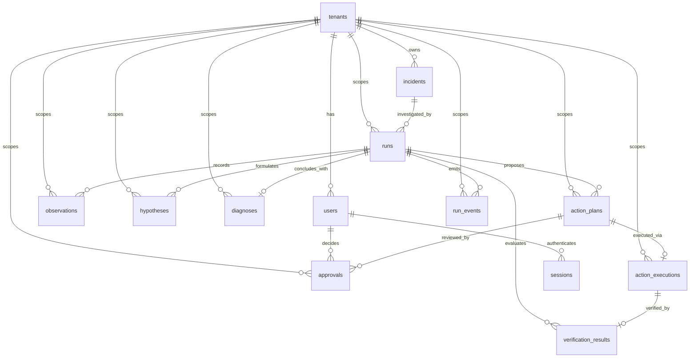

# OpsPilot Relational Data Model Specification

This document defines the formal relational database schema and persistence model for OpsPilot in PostgreSQL. It operationalizes the behavioral guarantees in [docs/outcome_contract.md](outcome_contract.md), the tool evidence envelope in [docs/tool_contract.md](tool_contract.md), the action vocabulary in `shared/actions.py`, and the evaluation grader models.

---

## 1. Entity-Relationship Overview

The database is split into two logical schemas:
1. `app`: All business domain tables, audit logs, state machines, approvals, and evidence records.
2. `checkpoints`: Dedicated schema owned exclusively by LangGraph for graph state checkpoints. **Nothing in `app` foreign-keys to `checkpoints`**.



---

## 2. Core Entity Tables

### 2.1 Multi-Tenancy, Users & Authentication

#### `tenants`
Logical organization boundary. Every operational entity carries a non-nullable `tenant_id`.

| Column | Type | Constraints | Description |
| :--- | :--- | :--- | :--- |
| `id` | `VARCHAR(64)` | `PRIMARY KEY` | Unique tenant slug (e.g., `tenant-default`, `org_acme`). |
| `name` | `VARCHAR(255)` | `NOT NULL` | Human-readable organization name. |
| `created_at` | `TIMESTAMPTZ` | `NOT NULL DEFAULT clock_timestamp()` | Creation timestamp in UTC. |
| `updated_at` | `TIMESTAMPTZ` | `NOT NULL DEFAULT clock_timestamp()` | Last update timestamp in UTC. |

#### `users`
Authenticated operators and reviewers with role-based authorization.

| Column | Type | Constraints | Description |
| :--- | :--- | :--- | :--- |
| `id` | `VARCHAR(64)` | `PRIMARY KEY` | Unique user identifier (e.g., `usr_admin_01`). |
| `tenant_id` | `VARCHAR(64)` | `NOT NULL REFERENCES tenants(id) ON DELETE RESTRICT` | Multi-tenant tenant boundary. |
| `email` | `VARCHAR(255)` | `NOT NULL` | User email address. |
| `role` | `VARCHAR(32)` | `NOT NULL CHECK (role IN ('viewer', 'reviewer', 'admin'))` | RBAC role: `viewer` (read-only), `reviewer` (approve/reject plans), `admin` (tenant management & emergency intervention). |
| `password_hash` | `VARCHAR(255)` | `NOT NULL` | Cryptographic password hash (bcrypt / argon2id). |
| `created_at` | `TIMESTAMPTZ` | `NOT NULL DEFAULT clock_timestamp()` | User creation timestamp. |
| `updated_at` | `TIMESTAMPTZ` | `NOT NULL DEFAULT clock_timestamp()` | Last profile update timestamp. |

*Table Constraints:*
- `UNIQUE (tenant_id, email)`

#### `sessions`
Active HTTP / UI bearer sessions.

| Column | Type | Constraints | Description |
| :--- | :--- | :--- | :--- |
| `token_hash` | `VARCHAR(64)` | `PRIMARY KEY` | SHA-256 hash of session bearer token. |
| `user_id` | `VARCHAR(64)` | `NOT NULL REFERENCES users(id) ON DELETE CASCADE` | Authenticated user reference. |
| `tenant_id` | `VARCHAR(64)` | `NOT NULL REFERENCES tenants(id) ON DELETE CASCADE` | Redundant tenant reference for tenant partition checks. |
| `expires_at` | `TIMESTAMPTZ` | `NOT NULL` | Absolute token expiration boundary. |
| `created_at` | `TIMESTAMPTZ` | `NOT NULL DEFAULT clock_timestamp()` | Session issuance timestamp. |

---

### 2.2 Incidents & Investigation Runs

#### `incidents`
Top-level incident envelope triggered by a deterministic threshold alert or synthetic seeded evaluation case.

| Column | Type | Constraints | Description |
| :--- | :--- | :--- | :--- |
| `id` | `VARCHAR(64)` | `PRIMARY KEY` | Unique incident ID (e.g., `inc_20261124_001`). |
| `tenant_id` | `VARCHAR(64)` | `NOT NULL REFERENCES tenants(id) ON DELETE RESTRICT` | Multi-tenant partition boundary. |
| `alert_id` | `VARCHAR(64)` | `NOT NULL` | Hash/ID of the triggering `AlertEvent` (e.g., `alt_932c5e86cb84`). |
| `source` | `VARCHAR(32)` | `NOT NULL CHECK (source IN ('alert', 'seeded_case'))` | Origin source: production threshold breach vs synthetic seeded benchmark. |
| `service` | `VARCHAR(64)` | `NOT NULL` | Alerting target microservice (e.g., `orders`, `inventory`, `gateway`). |
| `severity` | `VARCHAR(32)` | `NOT NULL CHECK (severity IN ('LOW', 'MEDIUM', 'HIGH', 'CRITICAL'))` | Severity level of triggering breach. |
| `alert_payload`| `JSONB` | `NOT NULL` | Full serialized `AlertEvent` dictionary conforming to the Feature 1.13 leakage-scanned schema. |
| `opened_at` | `TIMESTAMPTZ` | `NOT NULL` | Time when alert fired / incident opened. |
| `status_summary`| `VARCHAR(32)` | `NOT NULL DEFAULT 'open' CHECK (status_summary IN ('open', 'mitigated', 'resolved', 'escalated'))` | High-level lifecycle summary. |
| `created_at` | `TIMESTAMPTZ` | `NOT NULL DEFAULT clock_timestamp()` | Record insertion timestamp. |

#### `runs`
An individual execution / investigation attempt by OpsPilot on an incident. A single incident may have multiple runs if human requests re-investigation or after escalation.

| Column | Type | Constraints | Description |
| :--- | :--- | :--- | :--- |
| `id` | `VARCHAR(64)` | `PRIMARY KEY` | Unique run identifier (e.g., `run_7a8b9c1d`). |
| `tenant_id` | `VARCHAR(64)` | `NOT NULL REFERENCES tenants(id) ON DELETE RESTRICT` | Tenant boundary. |
| `incident_id` | `VARCHAR(64)` | `NOT NULL REFERENCES incidents(id) ON DELETE RESTRICT` | Owning incident. |
| `case_id` | `VARCHAR(64)` | `NULL` | Optional benchmark scenario ID (e.g. `S1`, `S4`) used exclusively by evaluation harnesses. |
| `idempotency_key`| `VARCHAR(128)` | `NULL` | Client-provided key on `POST /runs` to ensure idempotent run creation. |
| `status` | `VARCHAR(32)` | `NOT NULL CHECK (status IN ('queued', 'investigating', 'needs_review', 'approved', 'executing', 'verifying', 'completed', 'escalated'))` | Deterministic lifecycle state machine from `docs/outcome_contract.md`. |
| `version` | `INTEGER` | `NOT NULL DEFAULT 1` | Optimistic concurrency control version counter. Incremented on every status update. |
| `remaining_calls`| `INTEGER` | `NOT NULL DEFAULT 8 CHECK (remaining_calls >= 0 AND remaining_calls <= max_calls)` | Decrementing tool call budget. |
| `max_calls` | `INTEGER` | `NOT NULL DEFAULT 8 CHECK (max_calls > 0)` | Maximum tool call ceiling allowed for this run. |
| `last_error` | `JSONB` | `NULL` | Typed error envelope (`{code, message, details, remedy}`) if run halted or failed. |
| `created_at` | `TIMESTAMPTZ` | `NOT NULL DEFAULT clock_timestamp()` | Run initialization timestamp. |
| `updated_at` | `TIMESTAMPTZ` | `NOT NULL DEFAULT clock_timestamp()` | Timestamp of last state mutation. |
| `finished_at`| `TIMESTAMPTZ` | `NULL` | Timestamp when run reached terminal state (`completed` or `escalated`). |

*Table Constraints:*
- `UNIQUE (tenant_id, idempotency_key)`

---

### 2.3 Evidence Storage, Hypotheses & Diagnoses

#### `observations`
The permanent, append-only store for `EvidenceRecord` items captured by investigation tools. Replaces temporary in-memory stores and enables permanent auditability.

| Column | Type | Constraints | Description |
| :--- | :--- | :--- | :--- |
| `evidence_id` | `VARCHAR(64)` | `PRIMARY KEY` | Deterministic citation ID (e.g., `ev_metric_a1b2c3d4`). |
| `run_id` | `VARCHAR(64)` | `NOT NULL REFERENCES runs(id) ON DELETE RESTRICT` | Run that captured this observation. |
| `tenant_id` | `VARCHAR(64)` | `NOT NULL REFERENCES tenants(id) ON DELETE RESTRICT` | Tenant isolation boundary. |
| `tool` | `VARCHAR(64)` | `NOT NULL CHECK (tool IN ('get_metrics', 'search_logs', 'get_trace', 'list_deploys', 'get_deploy_diff'))` | Closed vocabulary of bounded investigation tools. |
| `source_id` | `VARCHAR(128)`| `NOT NULL` | Telemetry source identifier (e.g. `prometheus:orders:8000`, `traces:inventory`). |
| `captured_at` | `TIMESTAMPTZ` | `NOT NULL` | Time of tool RPC execution in UTC. |
| `window_start` | `TIMESTAMPTZ` | `NOT NULL` | Start boundary of investigated telemetry window. |
| `window_end` | `TIMESTAMPTZ` | `NOT NULL` | Strict "as-of" end boundary of investigated telemetry window. |
| `args` | `JSONB` | `NOT NULL` | Sanitized input arguments passed to tool. |
| `summary` | `TEXT` | `NOT NULL` | Plain text summary of findings for UI display (max 500 chars). |
| `payload` | `JSONB` | `NOT NULL` | Structured tool output envelope (metrics points, log rows, span tree, diff). |
| `source_version`| `VARCHAR(32)`| `NOT NULL DEFAULT 'v1'` | Schema version of source telemetry. |
| `content_hash` | `CHAR(64)` | `NOT NULL` | SHA-256 hash computed over canonical serialized JSON payload. |

#### `hypotheses`
Intermediate diagnostic hypotheses formulated, tracked, and updated by the agent during investigation.

| Column | Type | Constraints | Description |
| :--- | :--- | :--- | :--- |
| `id` | `VARCHAR(64)` | `PRIMARY KEY` | Unique hypothesis ID (e.g., `hyp_01`). |
| `run_id` | `VARCHAR(64)` | `NOT NULL REFERENCES runs(id) ON DELETE RESTRICT` | Investigating run. |
| `tenant_id` | `VARCHAR(64)` | `NOT NULL REFERENCES tenants(id) ON DELETE RESTRICT` | Tenant partition. |
| `statement` | `TEXT` | `NOT NULL` | Natural language hypothesis statement (e.g., "Orders connection pool leak caused by v1.3.0"). |
| `category` | `VARCHAR(64)` | `NOT NULL CHECK (category IN ('bad_deploy', 'dependency_failure', 'false_alarm', 'unknown'))` | Standard root cause category. |
| `mechanism` | `VARCHAR(64)` | `NOT NULL` | Technical failure mechanism (e.g., `connection_pool_exhaustion`, `cache_bypass_latency`). |
| `service` | `VARCHAR(64)` | `NULL` | Suspected microservice, or null if false alarm / unknown. |
| `status` | `VARCHAR(32)` | `NOT NULL DEFAULT 'open' CHECK (status IN ('open', 'supported', 'refuted'))` | Current validation status. |
| `supporting_evidence_ids`| `TEXT[]`| `NOT NULL DEFAULT '{}'` | Array of `observations.evidence_id` supporting this hypothesis. |
| `contrary_evidence_ids` | `TEXT[]`| `NOT NULL DEFAULT '{}'` | Array of `observations.evidence_id` refuting this hypothesis. |
| `confidence` | `NUMERIC(3, 2)`| `NOT NULL CHECK (confidence >= 0.00 AND confidence <= 1.00)` | Assessed probability between 0.00 and 1.00. |
| `created_at` | `TIMESTAMPTZ` | `NOT NULL DEFAULT clock_timestamp()` | Creation timestamp. |

#### `diagnoses`
The finalized, authoritative root cause diagnosis concluding an investigation run. Exactly one diagnosis is permitted per run.

| Column | Type | Constraints | Description |
| :--- | :--- | :--- | :--- |
| `id` | `VARCHAR(64)` | `PRIMARY KEY` | Unique diagnosis ID (e.g., `diag_7a8b9c1d`). |
| `run_id` | `VARCHAR(64)` | `NOT NULL REFERENCES runs(id) ON DELETE RESTRICT` | Investigating run. Exactly one per run. |
| `tenant_id` | `VARCHAR(64)` | `NOT NULL REFERENCES tenants(id) ON DELETE RESTRICT` | Tenant partition. |
| `root_cause_service`| `VARCHAR(64)`| `NULL` | Culpable service, or null if false alarm. |
| `root_cause_category`| `VARCHAR(64)`| `NOT NULL CHECK (root_cause_category IN ('bad_deploy', 'dependency_failure', 'false_alarm', 'unknown'))` | High-level failure category. |
| `mechanism` | `VARCHAR(64)` | `NOT NULL CHECK (mechanism IN ('connection_pool_exhaustion', 'cache_bypass_latency', 'dependency_timeout', 'none', 'unknown'))` | Concrete failure mechanism. |
| `culprit_deploy_id`| `VARCHAR(64)` | `NULL` | ID of culpable deployment record if `bad_deploy`, else null. |
| `evidence_ids` | `TEXT[]` | `NOT NULL DEFAULT '{}'` | Array of `observations.evidence_id` explicitly cited as proof. |
| `confidence` | `NUMERIC(3, 2)`| `NOT NULL CHECK (confidence >= 0.00 AND confidence <= 1.00)` | Self-reported diagnosis confidence. |
| `created_at` | `TIMESTAMPTZ` | `NOT NULL DEFAULT clock_timestamp()` | Finalization timestamp. |

*Table Constraints:*
- `UNIQUE (run_id)` (Enforces at most one diagnosis per investigation run).

---

### 2.4 Action Plans, Approvals & Execution Broker

#### `action_plans`
Proposed remediation action plan generated by the agent. **IMMUTABLE after insertion except for status, updated_at, and transition timestamps**.

| Column | Type | Constraints | Description |
| :--- | :--- | :--- | :--- |
| `id` | `VARCHAR(64)` | `PRIMARY KEY` | Unique plan identifier (e.g., `plan_01`). |
| `run_id` | `VARCHAR(64)` | `NOT NULL REFERENCES runs(id) ON DELETE RESTRICT` | Originating run. |
| `tenant_id` | `VARCHAR(64)` | `NOT NULL REFERENCES tenants(id) ON DELETE RESTRICT` | Tenant boundary. |
| `action` | `VARCHAR(32)` | `NOT NULL CHECK (action IN ('rollback_service', 'restart_service', 'no_action', 'escalate'))` | Canonical action vocabulary from `shared/actions.py`. |
| `service` | `VARCHAR(64)` | `NULL` | Target microservice (`orders`, `inventory`, `redis`, `gateway`). Required for rollback/restart; must be NULL for `no_action`/`escalate`. |
| `expected_version` | `VARCHAR(64)` | `NULL` | Target state precondition (e.g., current active image or version tag `v1.3.0`). Verified by broker prior to mutation. |
| `rationale_evidence_ids`| `TEXT[]` | `NOT NULL DEFAULT '{}'` | Cites supporting `observations.evidence_id` justifying this action. |
| `rollback_route` | `VARCHAR(255)`| `NULL` | Explicit reversal path (e.g., "Deploy orders v1.3.0" if rollback to v1.0.0 fails). |
| `plan_hash` | `CHAR(64)` | `NOT NULL` | SHA-256 hash over canonical JSON representation of `{action, service, expected_version, rationale_evidence_ids, rollback_route}`. |
| `status` | `VARCHAR(32)` | `NOT NULL DEFAULT 'proposed' CHECK (status IN ('proposed', 'approved', 'rejected', 'expired', 'superseded', 'executed', 'failed'))` | Plan review & execution state machine. |
| `notes` | `VARCHAR(300)` | `NOT NULL DEFAULT ''` | Plain text notes explaining proposal. |
| `expires_at` | `TIMESTAMPTZ` | `NOT NULL` | Approval timeout (created_at + `APPROVAL_TTL_SECONDS`). |
| `created_at` | `TIMESTAMPTZ` | `NOT NULL DEFAULT clock_timestamp()` | Plan generation timestamp. |
| `updated_at` | `TIMESTAMPTZ` | `NOT NULL DEFAULT clock_timestamp()` | Last status mutation timestamp. |

*Table Constraints:*
- `CHECK ((action IN ('rollback_service', 'restart_service') AND service IS NOT NULL) OR (action IN ('no_action', 'escalate') AND service IS NULL))`

#### `approvals`
Cryptographic human review record. A plan cannot be executed without a matching approval record.

| Column | Type | Constraints | Description |
| :--- | :--- | :--- | :--- |
| `id` | `VARCHAR(64)` | `PRIMARY KEY` | Unique approval record ID (e.g., `appr_01`). |
| `plan_id` | `VARCHAR(64)` | `NOT NULL REFERENCES action_plans(id) ON DELETE RESTRICT` | The action plan under review. |
| `tenant_id` | `VARCHAR(64)` | `NOT NULL REFERENCES tenants(id) ON DELETE RESTRICT` | Tenant partition. |
| `reviewer_id` | `VARCHAR(64)` | `NOT NULL REFERENCES users(id) ON DELETE RESTRICT` | Operator who reviewed the proposal. |
| `decision` | `VARCHAR(32)` | `NOT NULL CHECK (decision IN ('approve', 'reject'))` | Human judgment. |
| `submitted_plan_hash` | `CHAR(64)` | `NOT NULL` | Plan hash submitted by client UI. **Must strictly equal `action_plans.plan_hash`**. |
| `decided_at` | `TIMESTAMPTZ` | `NOT NULL DEFAULT clock_timestamp()` | Review decision timestamp. |
| `reason` | `TEXT` | `NOT NULL DEFAULT ''` | Mandatory review comments (especially on rejection). |

*Table Constraints:*
- `UNIQUE (plan_id, reviewer_id)` (A reviewer cannot vote more than once on the same plan).

#### `action_executions`
Execution dispatch record tracked by the isolated execution broker. Only the Broker service writes to this table.

| Column | Type | Constraints | Description |
| :--- | :--- | :--- | :--- |
| `id` | `VARCHAR(64)` | `PRIMARY KEY` | Unique execution tracking ID. |
| `plan_id` | `VARCHAR(64)` | `NOT NULL REFERENCES action_plans(id) ON DELETE RESTRICT` | Approved plan being executed. Exactly one execution per plan. |
| `tenant_id` | `VARCHAR(64)` | `NOT NULL REFERENCES tenants(id) ON DELETE RESTRICT` | Tenant boundary. |
| `action_key` | `VARCHAR(128)`| `NOT NULL UNIQUE` | Deterministic idempotency key: `hash(tenant_id, plan_id, plan_hash, expected_version)`. Prevents duplicate container operations. |
| `status` | `VARCHAR(32)` | `NOT NULL CHECK (status IN ('queued', 'dispatched', 'acknowledged', 'uncertain', 'reconciled', 'failed'))` | Broker execution state machine. |
| `attempts` | `INTEGER` | `NOT NULL DEFAULT 0 CHECK (attempts >= 0)` | Number of dispatch attempts made by broker. |
| `target_state_before` | `JSONB` | `NULL` | Container/deploy state captured immediately prior to mutation. |
| `target_state_after` | `JSONB` | `NULL` | Container/deploy state captured immediately post-mutation. |
| `dispatched_at` | `TIMESTAMPTZ` | `NULL` | Time command sent to container runtime or admin endpoint. |
| `completed_at` | `TIMESTAMPTZ` | `NULL` | Time broker verified container command termination. |
| `broker_response` | `JSONB` | `NULL` | Raw exit codes, stdout, or HTTP response from lab controller. |

*Table Constraints:*
- `UNIQUE (plan_id)` (At most one execution instance per plan).

---

### 2.5 Independent Verification & Audit Trail

#### `verification_results`
Programmatic outcome proof executed after broker mutation to independently verify SLA restoration.

| Column | Type | Constraints | Description |
| :--- | :--- | :--- | :--- |
| `id` | `VARCHAR(64)` | `PRIMARY KEY` | Unique verification result ID. |
| `run_id` | `VARCHAR(64)` | `NOT NULL REFERENCES runs(id) ON DELETE RESTRICT` | Owning run. |
| `execution_id` | `VARCHAR(64)` | `NOT NULL REFERENCES action_executions(id) ON DELETE RESTRICT` | The broker execution being verified. |
| `tenant_id` | `VARCHAR(64)` | `NOT NULL REFERENCES tenants(id) ON DELETE RESTRICT` | Tenant partition. |
| `pre_metrics` | `JSONB` | `NOT NULL` | Baseline error rate and p95 latency measured during incident window. |
| `post_metrics` | `JSONB` | `NOT NULL` | Post-recovery error rate and p95 latency measured over verification window. |
| `probe_result` | `JSONB` | `NOT NULL` | Results of synthetic HTTP health probes (3 consecutive requests). |
| `verdict` | `VARCHAR(32)` | `NOT NULL CHECK (verdict IN ('recovered', 'not_recovered', 'inconclusive'))` | Deterministic outcome evaluation. |
| `window_seconds` | `INTEGER` | `NOT NULL DEFAULT 30` | Duration of post-recovery observation window. |
| `created_at` | `TIMESTAMPTZ` | `NOT NULL DEFAULT clock_timestamp()` | Verification completion timestamp. |

*Table Constraints:*
- `UNIQUE (execution_id)` (One verification per execution).

#### `run_events`
Append-only operational timeline capturing every state change, agent tool call, human review interaction, and broker event.

| Column | Type | Constraints | Description |
| :--- | :--- | :--- | :--- |
| `id` | `BIGSERIAL` | `PRIMARY KEY` | Monotonic global sequencing identifier. |
| `run_id` | `VARCHAR(64)` | `NOT NULL REFERENCES runs(id) ON DELETE CASCADE` | Associated run. |
| `tenant_id` | `VARCHAR(64)` | `NOT NULL REFERENCES tenants(id) ON DELETE RESTRICT` | Tenant boundary. |
| `seq` | `INTEGER` | `NOT NULL` | Per-run monotonic sequence number ($1, 2, 3 \dots$). |
| `type` | `VARCHAR(64)` | `NOT NULL` | Event type (e.g. `run_queued`, `tool_dispatched`, `observation_created`, `plan_proposed`, `plan_approved`, `execution_started`, `verification_completed`). |
| `actor` | `VARCHAR(64)` | `NOT NULL` | Acting principal: `system`, `agent`, `reviewer:<user_id>`, `broker`. |
| `payload` | `JSONB` | `NOT NULL DEFAULT '{}'` | Event context, parameters, and metadata. |
| `created_at` | `TIMESTAMPTZ` | `NOT NULL DEFAULT clock_timestamp()` | Event emission timestamp. |

*Table Constraints:*
- `UNIQUE (run_id, seq)` (Guarantees strict linear per-run ordering).

---

## 3. Database vs. Application Enforced Invariants

To avoid silent data corruption and prevent bypass by any service, invariants are partitioned intentionally:

| Invariant / Constraint | Enforcement Layer | Justification |
| :--- | :--- | :--- |
| **Referential Integrity (FKs)** | **Database** | Guarantees that observations, plans, approvals, and events cannot orphan or reference non-existent tenants, runs, or users. |
| **Uniqueness & Idempotency** | **Database** | Unique constraints (`action_key`, `(tenant_id, idempotency_key)`, `(plan_id, reviewer_id)`, `(run_id, seq)`) eliminate race conditions at connection level. |
| **Enum & Value Validation** | **Database (`CHECK`)** | Ensures invalid status strings or illegal action/service combinations cannot be written by buggy workers or schema drift. |
| **Optimistic Locking (`version`)**| **Database & App** | State updates execute: `UPDATE runs SET status=:to, version=version+1 WHERE id=:id AND version=:old_version`. Eliminates concurrent split-brain updates. |
| **Row Level Security (RLS)** | **Database** | Tenant isolation policies (`tenant_id = current_setting('app.current_tenant')`) prevent cross-tenant queries even under application-layer logic bugs. |
| **Plan Immutability** | **Database (Trigger)** | `BEFORE UPDATE ON action_plans` trigger forbids altering `action`, `service`, `expected_version`, `rationale_evidence_ids`, or `plan_hash` once created. Only `status` and timestamps can transition. |
| **Tool Call Budget ($\le 8$)** | **Application & DB** | DB enforces `remaining_calls >= 0` with a `CHECK` constraint; Application agent terminates investigation before budget breach. |
| **Temporal "As-Of" Boundaries** | **Application** | Tool implementations filter observations strictly by `window_end` before persisting to `observations`. |
| **Cryptographic Hash Parity** | **Application** | Approval endpoint verifies `submitted_plan_hash == action_plans.plan_hash` before writing approval row. |

---

## 4. Run State Transitions & Authority Matrix

Operationalizing Section 5 of [docs/outcome_contract.md](outcome_contract.md):

| From State | To State | Trigger Condition | Authorized Principal | Notes |
| :--- | :--- | :--- | :--- | :--- |
| `queued` | `investigating` | Background worker acquires run lease. | `system:worker` | Increments `run.version`. |
| `investigating` | `needs_review` | Agent finalizes diagnosis and proposes `action_plan`. | `agent` | Requires valid `action_plans` row and `diagnoses` row. |
| `investigating` | `escalated` | Budget exhausted, contradictory evidence, or unresolvable failure. | `agent` \| `system:worker` | Populates `run.last_error`. |
| `needs_review` | `approved` | Reviewer approves plan within TTL with matching plan hash. | `reviewer:<user_id>` | Inserts `approvals` row with `decision='approve'`. |
| `needs_review` | `escalated` | Reviewer explicitly rejects plan, or plan TTL expires. | `reviewer:<user_id>` \| `system:timeout` | Inserts rejection approval or marks plan `expired`. |
| `approved` | `executing` | Execution Broker picks up approved plan. | `broker` | Creates `action_executions` with `status='dispatched'`. |
| `executing` | `verifying` | Broker acknowledges target mutation completed. | `broker` | Updates `action_executions.status='acknowledged'`. |
| `executing` | `escalated` | Broker encounters non-zero exit or ambiguous timeout. | `broker` | Marks execution `uncertain` or `failed`. Zero auto-retries. |
| `verifying` | `completed` | Post-recovery probe passes SLA recovery criteria. | `system:verifier` | Inserts `verification_results` with `verdict='recovered'`. |
| `verifying` | `escalated` | Verification probe detects continued SLA breach or degradation. | `system:verifier` | Inserts `verification_results` with `verdict='not_recovered'`. |
| `escalated` | `investigating` | Human requests re-investigation with new scope or parameters. | `reviewer:<user_id>` \| `admin` | Resets `remaining_calls` to budget; creates new run event. |

---

## 5. Indexing Plan for High-Frequency Queries

The 5 most frequent operational queries in OpsPilot and their corresponding index definitions:

```sql
-- 1. Review UI Incident List: Fetch open incidents for a tenant ordered by opening time
CREATE INDEX idx_incidents_tenant_opened 
ON incidents (tenant_id, status_summary, opened_at DESC);

-- 2. Agent / UI Active Run Lookup: Fetch active runs pending review or execution
CREATE INDEX idx_runs_tenant_status 
ON runs (tenant_id, status, updated_at DESC);

-- 3. Investigation Evidence Retrieval: Retrieve all evidence collected for a run
CREATE INDEX idx_observations_run_captured 
ON observations (run_id, captured_at ASC);

-- 4. Broker Plan Execution Lookup: Retrieve approved plan ready for execution
CREATE INDEX idx_action_plans_run_status 
ON action_plans (run_id, status);

-- 5. Audit Log Streaming: Stream ordered operational timeline events for a run
CREATE INDEX idx_run_events_run_seq 
ON run_events (run_id, seq ASC);
```

---

## 6. Idempotency Architecture

To prevent duplicate execution in distributed or unreliable network conditions:
1. **POST /runs Idempotency**:
   - Clients supply an `Idempotency-Key` HTTP header.
   - The API enforces `UNIQUE (tenant_id, idempotency_key)` on `runs`. Subsequent submissions return the existing run record without spawning duplicate agent graph threads.
2. **Action Execution Broker Idempotency (`action_key`)**:
   - Every execution calculates:
     $$\text{action\_key} = \text{SHA-256}(\text{tenant\_id} \parallel \text{plan\_id} \parallel \text{plan\_hash} \parallel \text{expected\_version})$$
   - `action_executions.action_key` is constrained with `UNIQUE`.
   - The broker service performs atomic insert: `INSERT INTO action_executions ... ON CONFLICT (action_key) DO NOTHING`. If a key exists, the broker skips dispatch and inspects the existing execution record.
3. **Approval Idempotency**:
   - `approvals` table enforces `UNIQUE (plan_id, reviewer_id)`. Concurrent or repeated clicks on "Approve" produce a no-op idempotency response.

---

## 7. LangGraph `checkpoints` Schema Isolation

LangGraph state checkpointing (for conversational and graph loop state) is stored in the same PostgreSQL cluster but isolated into a dedicated schema:
```sql
CREATE SCHEMA checkpoints;
```

### Strict Isolation Rules
1. **Schema Boundary**: LangGraph engine tables (`checkpoints.checkpoints`, `checkpoints.checkpoint_blobs`, `checkpoints.checkpoint_writes`) reside strictly inside the `checkpoints` schema.
2. **No Foreign Keys from `app`**: Tables in the `app` schema **never** contain foreign keys or column references to `checkpoints` tables.
3. **Domain Decoupling**: If the agent's graph checkpoint storage is wiped, pruned, or migrated to a different backend (e.g., Redis or in-memory), all core `app` tables (`runs`, `observations`, `diagnoses`, `action_plans`, `approvals`, `run_events`) remain 100% intact, readable, and auditable.
4. **Data Ownership**: Core business state (whether a plan is approved or executed) is authoritative in `app.action_plans` and `app.action_executions`, never derived from LangGraph internal graph state blobs.

---

## 8. Retention and Deletion Stance

For OpsPilot as a production portfolio and enterprise evaluation system, data retention follows a pragmatic, audit-first stance:

1. **Development & Lab Environments**:
   - Data is retained for **14 days**.
   - An automated background purge job deletes completed/escalated runs older than 14 days along with their associated `observations`, `hypotheses`, and `run_events` via `ON DELETE CASCADE`.
   - `make reset` provides a manual command to drop and recreate database volumes cleanly during development.
2. **Evaluation & Sealed Benchmark Runs**:
   - Benchmark evaluation runs (`runs.case_id IS NOT NULL`) are flagged with immutable retention. They are excluded from automatic purge jobs to preserve reproducible scoring data.
3. **No Soft Deletion Complexity**:
   - Soft deletion flags (`is_deleted`) are omitted to keep queries simple and performant. Incidents and runs exist until explicitly archived or purged.

---

## 9. Open Questions for Human Reviewer

Please review the following open architectural questions and advise before implementation:

1. **Incidents vs. Runs Separation**:
   Currently, the design separates `incidents` (the external problem envelope / alert trigger) from `runs` (a single investigation attempt by the agent). This enables human operators to request a "re-investigation" (Run 2) on the same incident if an initial plan was rejected or failed verification. Do you prefer maintaining this 1-to-many separation, or should `incidents` and `runs` be collapsed into a single 1-to-1 table for simplicity?
2. **Payload Storage for Large Observations**:
   In `observations.payload`, raw tool outputs (e.g., 200 lines of logs or span trees) are stored directly as `JSONB`. In local testing, payloads are $<64\text{ KB}$. Should we keep `payload JSONB` inline in PostgreSQL, or should payloads $>16\text{ KB}$ be offloaded to local filesystem/S3 pointers (`payload_ref`)?
3. **Multi-Reviewer Quorum**:
   Currently, an action plan transitions to `approved` upon **one** valid reviewer approval (`UNIQUE(plan_id, reviewer_id)`). For critical production operations, should the schema support a configurable `approvals_required` quorum (e.g. 2 reviewers required for production rollbacks), or is single-reviewer approval sufficient for MVP?
4. **Tenant Provisioning**:
   Should tenant creation be fully automated via API endpoints, or strictly bootstrapped via database migration seeds (`tenant-default`)?
