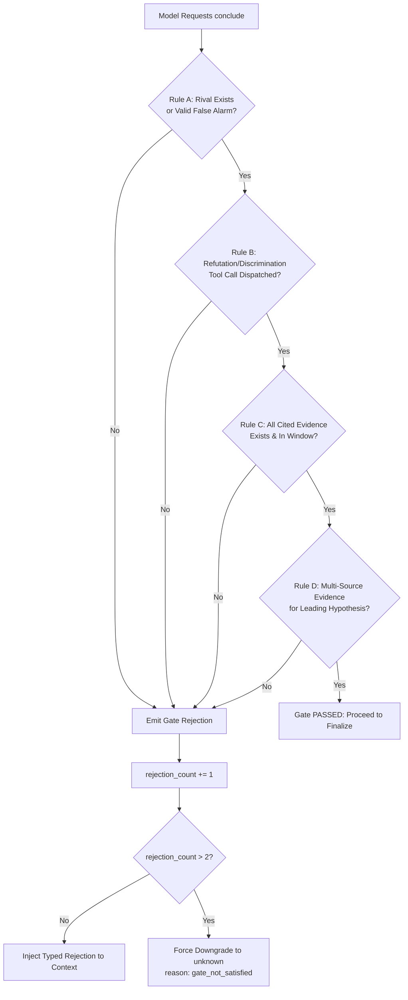

# OpsPilot Hypothesis Tracking & Contrary-Evidence Gate Design Specification

> **Specification Status**: Proposed Architecture Specification (Feature 6)  
> **Target Document**: `docs/hypothesis_design.md`  
> **Relevant Features**: Feature 6 (Hypothesis Tracking & Contrary Evidence), Feature 5 (Investigator Agent Graph), Feature 1.12 (Diagnosis Schema), Feature 1.13 (Leakage Guard), Feature 0.7 (LLM Interface), Feature 2.10 (Tool Registry), Feature 13 (Agent Value Gate).  
> **Implementation Stance**: Architecture & Contract Specification (**NO Code Execution**). Awaiting explicit human approval.

---

## 1. Failure Behaviours Observed in v1 Live Evaluation

Based on the empirical trajectories and failure modes analyzed in [docs/investigator_report_v1.md](investigator_report_v1.md) and candidate v2 notes in [docs/prompt_changelog.md](prompt_changelog.md), the hypothesis engine must address the following specific failure behaviours:

1. **Confirmation Bias & Anchor Bias**: The agent fixes on the first anomalous telemetry signal or recent deploy found, halting inquiry without exploring plausible competing root causes.
2. **Decoy Deploy Susceptibility**: The agent misattributes downstream infrastructure degradation (e.g., dependency timeouts) to unrelated benign software deployments on upstream services simply due to temporal correlation.
3. **Absence of Falsification Testing**: The agent gathers evidence purely to confirm an initial hunch, never issuing queries explicitly designed to disprove its working theory.
4. **Premature Conclusion Under Ambiguity**: The agent concludes a definitive diagnosis when telemetry is noisy, ambiguous, or incomplete, rather than abstaining with epistemic honesty.
5. **Telemetry Budget Exhaustion via Unfocused Probing**: The agent expends its limited tool call quota on exploratory probes without structured discriminative intent, depleting quota before reaching root cause isolation.
6. **Unverified False Alarm Dismissal**: The agent either ignores transient threshold spikes entirely or guesses an underlying defect instead of systematically verifying return-to-baseline telemetry.

---

## 2. Hypothesis Ledger Specification

The Hypothesis Ledger is an explicit, audit-trailed state container maintained during the investigation. It tracks the lifecycle of candidate explanations from formulation through discriminative testing to final evaluation.

### 2.1 Ledger Fields

| Field Name | Type | Allowed Values / Constraints | Description |
| :--- | :--- | :--- | :--- |
| `hypothesis_id` | `str` | Format: `hyp_[0-9a-f]{4}` (e.g., `hyp_01a2`). | Unique local identifier for the hypothesis within the run. |
| `statement` | `str` | Max 200 characters. Plain text. | Concrete proposition (e.g., *"Orders connection pool exhausted due to leak in v1.3.0"*). |
| `category` | `str` | `bad_deploy` \| `dependency_failure` \| `false_alarm` \| `unknown` | High-level root cause category aligned with `evals.graders.models.Diagnosis`. |
| `mechanism` | `str` | Closed set: `connection_pool_exhaustion`, `cache_bypass_latency`, `dependency_timeout`, `none`, `unknown`. | Concrete technical mechanism. |
| `service` | `str \| None` | Target service from topology allowlist, or `None` if `false_alarm`/`unknown`. | Microservice suspected of originating the fault. |
| `status` | `str` | `open` \| `supported` \| `refuted` \| `inconclusive` | Validation status updated via discriminative evidence. |
| `supporting_evidence_ids` | `list[str]` | Valid `evidence_id` references from `app.observations`. | Observations that confirm or corroborate this hypothesis. |
| `contrary_evidence_ids` | `list[str]` | Valid `evidence_id` references from `app.observations`. | Observations that disconfirm, contradict, or rule out this hypothesis. |
| `tests_run` | `list[str]` | List of tool names / sequence numbers dispatched against it. | Audit list of tool queries executed to evaluate this hypothesis. |
| `confidence` | `float` | `0.00` to `1.00`. | Model's self-assessed probability (logged, but subject to deterministic caps). |
| `created_step` | `int` | $\ge 1$. | Step number at which the hypothesis was first added to the ledger. |
| `updated_step` | `int` | $\ge \text{created_step}$. | Step number of the most recent status or evidence mutation. |

### 2.2 Ledger Invariants & Budget Limits

- **Maximum Hypotheses Per Run**: Fixed at **4** (`MAX_HYPOTHESES = 4`).
  - *Rationale*: A cap of 4 allows 1 primary hypothesis, 1–2 rival hypotheses (e.g., dependency failure vs bad deploy), and 1 false-alarm alternative. It prevents context bloat, avoids combinatorial testing explosions, and forces the model to prioritize plausible causes.
- **Immutability of Identity**: Once created, a `hypothesis_id` retains its original `category`, `mechanism`, and `service`. If the model pivots to a new explanation, it must open a new hypothesis rather than mutating the identity of an existing one.
- **Storage**: Persisted to PostgreSQL table `app.hypotheses` (from [docs/data_model.md](data_model.md) Section 2.3) at finalization, and mirrored in LangGraph `InvestigationState` as a compact dictionary.

---

## 3. Step Schema v2

To enforce scientific hypothesis testing, the model step schema is expanded. Every tool execution must declare its discriminative objective, and hypotheses must be manipulated through typed operations.

### 3.1 Step Schema Discriminator

The turn schema output by the model is a tagged union of three possible actions:
```json
{
  "step": "call_tool" | "update_hypotheses" | "conclude"
}
```

### 3.2 `call_tool` Step (v2)

```json
{
  "step": "call_tool",
  "tool": "search_logs",
  "args": {
    "service": "orders",
    "query": "pool exhausted"
  },
  "tests_hypothesis_id": "hyp_01a2",
  "expected_if_true": "Log contains 'DB connection pool exhausted' errors within the incident window.",
  "expected_if_false": "Log contains zero connection pool errors; queries complete normally.",
  "reason": "Test whether orders is actively failing on DB connections versus upstream network drops."
}
```

#### Why Each Field Exists:
- `tests_hypothesis_id` (`str | None`): Declares which hypothesis on the ledger this query is intended to validate, refute, or discriminate against a rival. Forces intentionality rather than aimless telemetry browsing.
- `expected_if_true` (`str`, max 150 chars): Plain-language prediction of what the observation payload will look like if the hypothesis is correct.
- `expected_if_false` (`str`, max 150 chars): Plain-language prediction of what will be observed if the hypothesis is false or a rival explanation holds.
- *Scientific Objective*: Together, `expected_if_true` and `expected_if_false` establish a pre-registered expectation before observing data, defeating hindsight rationalization and confirmation bias.

### 3.3 `update_hypotheses` Step (New)

The model emits this step to initialize new candidate hypotheses, link gathered evidence, or update validation status.

```json
{
  "step": "update_hypotheses",
  "operations": [
    {
      "op": "add",
      "statement": "Inventory downstream database latency causes gateway timeout",
      "category": "dependency_failure",
      "mechanism": "dependency_timeout",
      "service": "inventory",
      "confidence": 0.70
    },
    {
      "op": "link_evidence",
      "hypothesis_id": "hyp_01a2",
      "evidence_id": "ev_logs_7fd9920a",
      "relation": "supports"
    },
    {
      "op": "link_evidence",
      "hypothesis_id": "hyp_02b3",
      "evidence_id": "ev_deploys_a9c5af05",
      "relation": "contradicts"
    },
    {
      "op": "set_status",
      "hypothesis_id": "hyp_02b3",
      "status": "refuted"
    }
  ],
  "reason": "Log confirms orders connection pool leak; deploy diff confirms no code changes in inventory."
}
```

#### Operations Vocabulary:
1. `add`: Registers a new hypothesis. Assigns the next sequential ID (`hyp_01` .. `hyp_04`). Rejected if ledger is full ($\ge 4$).
2. `link_evidence`: Associates a verified `evidence_id` to a hypothesis with relation `supports` or `contradicts`.
3. `set_status`: Mutates hypothesis validation status to `open`, `supported`, `refuted`, or `inconclusive`.

#### Why This Step Exists:
- Separates cognitive state evaluation from tool execution.
- Eliminates hidden reasoning by requiring explicit, auditable mutations to the shared ledger.
- Prevents prompt token explosion by recording structured updates rather than conversational prose.

### 3.4 `conclude` Step (v2)

```json
{
  "step": "conclude",
  "leading_hypothesis_id": "hyp_01a2",
  "reason": "Primary hypothesis confirmed by dual-source evidence and rival deploy hypothesis refuted."
}
```

#### Why This Field Exists:
- `leading_hypothesis_id` (`str`): Direct pointer to the winning hypothesis on the ledger.
- The system extracts the final `Diagnosis` artifact directly from the ledger record of `leading_hypothesis_id`. The model is **not** permitted to generate free-form diagnoses disconnected from the ledger history.

---

## 4. The Contrary-Evidence Gate

The Contrary-Evidence Gate is a deterministic, non-LLM validation checkpoint in the `plan_step -> conclude` edge. It prevents the agent from finalizing an incident until it has met strict empirical rigor standards.

### 4.1 Gate Rules (Mechanical Criteria)

When the model proposes a `conclude` step, the gate checks all of the following rules:



#### Rule (a): Dual Hypothesis or False-Alarm Exception
- **Requirement**: At least **two** distinct hypotheses must have been created on the ledger during the run, **OR**
- **Exception**: An explicit `"no plausible rival"` justification is provided, which is accepted **only** if:
  1. The category is `false_alarm`, AND
  2. The triggering alert matches known transient-burst patterns (e.g., metric spikes that subsided within $<60$ seconds with zero downstream errors).

#### Rule (b): Falsification / Discrimination Test Dispatched
- **Requirement**: At least one tool call in `tool_trace` had `tests_hypothesis_id` pointing to either:
  1. A rival hypothesis that was tested and marked `refuted`, OR
  2. The leading hypothesis where the query was designed to refute it, and the observation was linked with `relation: "contradicts"` against a rival or `relation: "supports"` confirming the leading theory over the alternative.

#### Rule (c): Evidence Groundedness & Incident Window Validity
- **Requirement**: Every `evidence_id` in the leading hypothesis's `supporting_evidence_ids` must:
  1. Exist in the run's `app.observations` store.
  2. Have `window_start` and `window_end` overlapping the incident's active time window.
  3. Originate from an authorized read tool (`get_metrics`, `search_logs`, `get_trace`, `list_deploys`, `get_deploy_diff`).

#### Rule (d): Independent Multi-Source Telemetry
- **Requirement**: The leading hypothesis must cite at least two supporting evidence items originating from **at least two independent source kinds**.
  - Allowed Source Kinds: `metrics`, `logs`, `traces`, `deploys`.
  - *Example Valid*: 1 metric observation (`get_metrics`) + 1 log observation (`search_logs`).
  - *Example Valid*: 1 trace observation (`get_trace`) + 1 deploy record (`list_deploys`).
  - *Example Invalid*: 2 metric queries on different parameters without logs or traces.

### 4.2 Rejection Handling & Downgrade State Machine

If any gate rule fails:
1. **Rejection Turn**: The graph increments `gate_rejection_count` in state, writes an event `gate_rejection_emitted` to `app.run_events`, and injects a typed rejection payload into the model's next turn prompt:
   ```json
   {
     "status": "rejected",
     "code": "gate_not_satisfied",
     "violations": [
       "Rule B: No tool call was dispatched to test or refute a rival hypothesis.",
       "Rule D: Leading hypothesis relies solely on 'metrics'; requires an independent telemetry source (logs, traces, or deploys)."
     ],
     "remaining_rejections": 1,
     "directive": "Dispatch a tool call to test a rival hypothesis or collect corroborating logs/traces before concluding."
   }
   ```
2. **Cap on Rejections**: Maximum **2** rejections allowed per run (`MAX_GATE_REJECTIONS = 2`).
3. **Forced Downgrade**: If the model fails the gate on its 3rd attempt, or if `remaining_calls` exhausts while under gate rejection:
   - The graph overrides the conclusion.
   - Sets `draft_diagnosis.root_cause_category = "unknown"`.
   - Sets `draft_diagnosis.mechanism = "unknown"`.
   - Sets `termination_reason = "gate_not_satisfied"`.
   - Transitions run status to `escalated`.
   - Preserves all gathered evidence and ledger history for human review.

---

## 5. Outcomes, Typed Reasons & Lifecycle Transitions

Every completed run terminates with an explicit outcome, mapped to a standardized reason code and PostgreSQL status transition.

| Outcome | Typed Reason | Trigger Condition | Final Diagnosis | Run Status Transition |
| :--- | :--- | :--- | :--- | :--- |
| **`diagnosed`** | `concluded_by_model` | Gate passed; leading hypothesis supported with multi-source evidence and rival tested. | Category & mechanism from leading hypothesis; confidence determined by deterministic rules. | `needs_review` (Feature 7) or `escalated` (Feature 5 stub) |
| **`diagnosed`** | `false_alarm_no_action` | Gate passed; alert proven transient; metrics returned to baseline; no errors found. | `category: false_alarm`, `mechanism: none`, `service: None`. | `needs_review` (recommends `no_action`) |
| **`unknown`** | `insufficient_evidence` | Call budget exhausted without satisfying multi-source proof or isolating root cause. | `category: unknown`, `mechanism: unknown`, citing all valid evidence collected so far. | `escalated` |
| **`unknown`** | `contradictory_evidence` | Ledger contains conflicting, unrefuted evidence (e.g., memory leak logs but metrics flat). | `category: unknown`, citing conflicting observations. | `escalated` |
| **`unknown`** | `evidence_unavailable` | Critical telemetry queries failed due to tool/backend errors (e.g., database timeout). | `category: unknown`, citing tool error details. | `escalated` |
| **`unknown`** | `budget_exhausted` | Step cap or tool call budget reached before conclusion was formulated. | `category: unknown`, citing partial findings. | `escalated` |
| **`unknown`** | `gate_not_satisfied` | Model attempted to conclude 3 times without satisfying the contrary-evidence gate. | `category: unknown`, citing unfulfilled gate checks. | `escalated` |
| **`escalate`** | `multiple_concurrent_causes` | Evidence confirms two or more distinct, simultaneous root causes across microservices. | `category: unknown`, summarizing multiple identified faults. | `escalated` |

---

## 6. Deterministic Confidence Caps

The model's self-reported confidence is stored in `app.hypotheses.confidence` for calibration scoring, but is **never used to make operational decisions**. The authoritative diagnosis confidence is computed deterministically:

| Investigation State / Condition | Maximum Allowed Confidence | Nominal Category |
| :--- | :---: | :--- |
| Any tool error occurred during a discriminating test | **0.30** | `low` |
| No rival hypothesis was tested or falsified | **0.30** | `low` |
| Unrefuted contrary evidence remains linked to leading hypothesis | **0.30** | `low` |
| Leading hypothesis supported by only a single source kind (e.g., metrics only) | **0.60** | `medium` |
| Gate satisfied with 1 rival refuted, but total evidence items $< 3$ | **0.75** | `medium` |
| Gate satisfied with $\ge 2$ independent source kinds, rival refuted, zero tool errors, and $\ge 3$ verified evidence items | **0.95** | `high` |
| False alarm certified with baseline return evidence across full incident window | **0.90** | `high` |

*Deterministic Override Formula*:
$$\text{Effective Confidence} = \min(\text{Model Assessed Confidence}, \text{Deterministic Cap})$$

---

## 7. Representation & Verification of False Alarms

False alarms are first-class diagnostic outcomes. Handling them safely prevents unnecessary service restarts or rollbacks.

### 7.1 Schema Representation
- `root_cause_category`: `"false_alarm"`
- `mechanism`: `"none"`
- `root_cause_service`: `None`
- `action`: `"no_action"` (for Feature 7 Action Proposal)

### 7.2 Evidence Required to Claim a False Alarm
To conclude `false_alarm`, the agent must provide:
1. **Transient Burst Evidence**: Metric observations demonstrating that the alerting metric (e.g., latency, error rate, queue depth) breached threshold temporarily but returned to within normal operating bounds ($\le 1.10 \times \text{baseline}$) before the end of the query window.
2. **Clean Telemetry Evidence**: Log or trace observations covering the breach timestamp confirming:
   - Zero fatal/unhandled application exceptions.
   - Zero cascading errors in downstream dependencies.
   - Normal HTTP 200 response codes resuming immediately post-burst.
3. If metric elevation persists at the end of the telemetry window, a `false_alarm` conclusion is **strictly rejected** by the gate.

---

## 8. Handling Simultaneous Multiple Concurrent Failures

### 8.1 Specification: Immediate Escalation
If evidence reveals two or more independent, simultaneous root causes (for example, an Orders connection pool leak occurring concurrently with an Inventory database timeout):
1. **Decision**: The agent must **NOT** attempt to diagnose both or sequence recovery plans.
2. **Action**: Immediately conclude with `outcome: escalate`, `reason: multiple_concurrent_causes`.
3. **Status Transition**: Transition run directly to `escalated`.

### 8.2 Architectural Rationale
- **Single-Fault Contract Boundary**: The current OpsPilot safety envelope and automated verification harness assume single-root causes.
- **Cascading Blast Radius**: Attempting automated multi-point remediation (e.g., rolling back Service A while restarting Service B) carries severe risk of split-brain states, race conditions in DB migrations, and compounding cluster failures.
- **Human Cognitive Offload**: SRE intervention is mandatory when multi-service correlation indicates potential network partitions or shared infrastructure collapse.

---

## 9. Evaluation Metrics for Feature 6

To evaluate the hypothesis engine against baselines B0, B1, B2 and Feature 5 v1, the evaluation harness will report:

1. **Diagnosis Accuracy**: Percentage of incidents where `(root_cause_category, mechanism, root_cause_service, culprit_deploy)` matches ground truth. Target: $\ge 80\%$.
2. **Abstention Rate**: Percentage of runs that legitimately conclude `unknown` due to insufficient/contradictory telemetry.
3. **Escalation Rate**: Percentage of runs escalated to human operators. Target: $\le 20\%$ on standard scenarios.
4. **Gate Rejection Frequency**: Average number of gate rejections emitted per run (tracks model learning curve and prompt adherence).
5. **Average Hypotheses Formulated**: Mean count of hypotheses registered per run (optimal: 2.0 to 3.5).
6. **Tool Call Efficiency**: Mean tool calls per successful diagnosis.
7. **Overly Cautious Rate**: Runs that abstained (`unknown`) when sufficient evidence was accessible in telemetry.
8. **Overconfident Rate**: Runs that diagnosed a root cause when evidence was insufficient, contradictory, or absent (Goal: $0\%$).

---

## 10. Anti-Gaming Protections

Large language models may attempt to "game" deterministic gates by adding superficial tokens or dummy steps simply to tick compliance boxes. The following mechanical checks prevent gaming:

| Gaming Strategy | Description | Catch Mechanism / Verification Check |
| :--- | :--- | :--- |
| **Fictitious / Strawman Rival** | Adding an absurd rival hypothesis (e.g., *"Meteor strike on server rack"* or naming a non-existent service) to satisfy Rule (a). | **Topology Allowlist Check**: The hypothesis `service` must belong to the active incident topology. The `mechanism` must belong to the closed enum vocabulary. Hypotheses with unknown services/mechanisms are rejected at `update_hypotheses`. |
| **No-Op Refutation Probing** | Issuing a meaningless query (e.g., `get_metrics` for an unrelated service) to satisfy Rule (b). | **Targeted Argument Match**: The tool call's arguments must target the specific `service` or `dependency` referenced in `tests_hypothesis_id`. |
| **Unlinked Test Result** | Calling a tool with `tests_hypothesis_id`, but never evaluating or linking the resulting observation. | **Mandatory Link Invariant**: Before `conclude` is accepted, the observation generated by the test query must be linked to the ledger with relation `supports` or `contradicts`. |
| **Synthetic Citation Bloat** | Citing multiple metric queries with identical parameters to artificially satisfy Rule (d). | **Source Kind Diversity**: Rule (d) strictly measures diversity of source kinds (`metrics`, `logs`, `traces`, `deploys`), not the count of citations. Multiple queries of the same tool type count as 1 source kind. |
| **Pre-Determined Falsification** | Marking a rival `refuted` without linking any disconfirming evidence. | **Status Precondition Check**: A hypothesis cannot transition from `open` to `refuted` unless at least one valid `evidence_id` is linked with `relation: "contradicts"`. |

---

## 11. Open Questions for User Approval

The following architectural decisions are open for your direction:

1. **Gate Rejection Penalty vs Budget**: When a gate rejection occurs, should the rejection turn itself decrement the remaining tool call budget (`remaining_calls`), or should it only increment the `step_count` without reducing tool allowance?
2. **False-Alarm Horizon**: How many minutes of post-alert baseline metric telemetry must be retrieved by the agent before certifying a `false_alarm` (e.g., 5 minutes vs 15 minutes)?
3. **Hypothesis Initialization in Turn 1**: Should the graph automatically inject a default baseline hypothesis (e.g., alert service anomaly) into the ledger at `load_context`, or should hypothesis formulation be 100% driven by the model's first step?
4. **Tool Batching in Step Schema**: Should `call_tool` remain strictly 1 tool per turn, or should we support batching up to 2 read queries in a single turn to conserve provider quota?
5. **Handling Inconclusive Rivals**: If a rival hypothesis is tested but returns inconclusive evidence (e.g. empty logs), is it sufficient for the gate if marked `inconclusive`, or must it be strictly `refuted` to allow conclusion?
