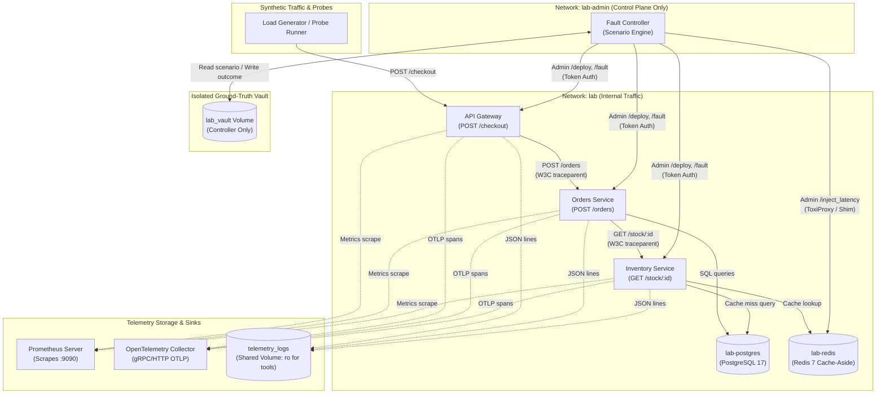
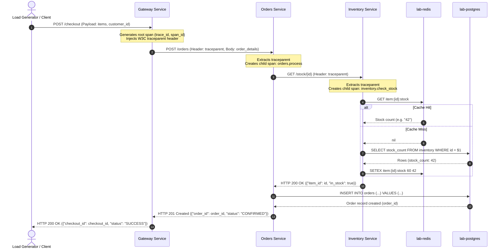

# OpsPilot Lab Design Specification

## Overview & Purpose

The **OpsPilot Lab** is a self-contained, reproducible, multi-service synthetic test environment that simulates production microservice architectures and realistic incident patterns. It provides the empirical substrate upon which the OpsPilot investigation agent operates:

1. **Realistic Diagnostic Surface**: Emits authentic signals across metrics (Prometheus), distributed traces (OpenTelemetry with W3C propagation), and structured logs (JSON with trace-log correlation).
2. **Hidden Ground Truth**: Every incident scenario is driven by an authoritative ground-truth vault accessible **only** to the scenario controller. The agent, API, and target services have zero direct visibility into the vault.
3. **Simulated In-Process Deploys**: Deployments and rollbacks are executed by switching version profiles in-process via authenticated admin endpoints over a segregated network (`lab-admin`). This completely eliminates any requirement to mount the host Docker socket into the lab or control plane.
4. **Reproducible Failure Families**: Deterministic injection of connection pool exhaustion, latency regressions, dependency timeouts with and without decoy deploys, and load-spike false alarms.

---

## 1. System Topology & Network Isolation

### Architecture Diagram



### Network Segregation & Trust Boundaries

The lab infrastructure enforces strict network boundaries:

| Network / Volume | Members | Isolation & Access Rules |
| :--- | :--- | :--- |
| `lab` (Compose internal) | `gateway`, `orders`, `inventory`, `lab-postgres`, `lab-redis`, `load-generator` | Service-to-service communication only. No external internet routing. Cannot reach `core` (agent/api) or `lab-admin`. |
| `lab-admin` (Compose internal) | `fault-controller`, `gateway`, `orders`, `inventory`, dependency shims | Admin control plane only. Carries profile deployments, fault injections, and resets. Completely inaccessible to the agent, API, or external callers. |
| `telemetry_logs` (Named volume) | `gateway` (`rw`), `orders` (`rw`), `inventory` (`rw`), Read Tools / Evaluator (`ro`) | Contains structured JSON log streams. Read tools mount this volume strictly in read-only mode (`:ro`). |
| `lab_vault` (Named volume) | `fault-controller` (`rw` only) | Contains ground-truth manifests, active incident states, and evaluation keys. Never mounted by any other container. |

> [!IMPORTANT]
> The LLM worker and FastAPI service never join `lab` or `lab-admin`. All agent evidence gathering occurs through bounded read tools querying telemetry endpoints (`/metrics`, `/traces`, and read-only log mounts). All remediation proposals are executed via the separate `broker` service.

---

## 2. Request Flow & Trace Propagation

### Checkout Transaction Flow



### Context Propagation Specification
- **Trace Context**: W3C `traceparent` (e.g. `00-4bf92f3577b34da6a3ce929d0e0e4736-00f067aa0ba902b7-01`) is passed via HTTP request headers across all service hops.
- **Span Correlation**: Every child span sets its `parent_id` from the inbound `traceparent`.
- **Database & Cache Spans**: DB queries and Redis commands generate client spans (`db.system=postgresql`, `db.system=redis`) tagged with the active `trace_id` and `span_id`.

---

## 3. Simulated Deployment Mechanism

To eliminate the Docker socket without sacrificing realism, deployments and rollbacks are **simulated in-process**:

### Mechanics
1. Each lab service (`gateway`, `orders`, `inventory`) packages multiple built-in version profiles:
   - Profile `v1.0.0`: Golden baseline configuration and clean code paths.
   - Profile `v1.0.1` / `v1.1.0`: Release profiles (some carrying specific behavioral regressions or bug fixes).
2. Each service exposes a private administrative port (e.g., `:9001`) listening **strictly on the `lab-admin` network**.
3. Admin endpoints require an `X-Admin-Token` secret shared only with the `fault-controller` and `broker`:
   - `POST /admin/deploy`: Switches active version profile in memory. Triggers configuration reload, connection pool re-initialization, or handler branch switching.
   - `POST /admin/rollback`: Reverts active profile to the designated prior version.
   - `GET /admin/profile`: Returns current running version, commit SHA, and profile activation timestamp.
4. **Deploy Metadata Store**: When a deploy or rollback occurs, the service records an event in its deploy log (exposed via a read-only metadata API endpoint `GET /api/v1/deployments` for the investigation agent):
   - `version`: e.g. `v1.1.0`
   - `commit_sha`: e.g. `7f8a9b2`
   - `deployed_at`: ISO 8601 timestamp
   - `deployed_by`: e.g. `ci-cd-bot@opspilot.local`
   - `changelog`: Authentic human-authored release notes (e.g. "Refactor inventory lookup and query caching").

---

## 4. Failure Families Specification

The lab provides five primary failure families (F1 through F5) representing standard cloud-native failure modes:

### F1: Connection Pool Leak (`pool_leak`)
- **Target Service**: `orders`
- **Mechanism**: Profile `v1.1.0` of `orders` introduces a regression in one specific branch of `POST /orders` (e.g., when order total exceeds \$100 or when processing guest checkouts): the connection is acquired from the pool but an early return / unhandled exception bypasses `release()`.
- **Progression**:
  1. Connection pool active count (`db_pool_active`) climbs monotonically until reaching max pool capacity (`max_connections=10`).
  2. Latency increases sharply as subsequent requests wait on `db_pool_waiting` up to the connection acquisition timeout (e.g., 5.0s).
  3. Connection requests time out, producing HTTP 503 Service Unavailable / HTTP 500 on `POST /orders`, propagating upstream as checkout failures.
- **Expected Signatures**:
  - **Metrics**: `orders_db_pool_active` reaches 10/10; `orders_db_pool_waiting` spikes; `http_requests_total{service="orders",status="503"}` rises; upstream `gateway` error rate spikes.
  - **Logs**: `orders` logs emit: `{"level":"error","event":"db_pool_timeout","message":"Timeout acquiring connection from pool after 5000ms"}`.
  - **Traces**: Spans for `orders.db_connect` take 5000ms and conclude with `status="ERROR"` and `exception.type="PoolTimeoutError"`.
  - **Deploy**: Recent deploy of `orders` (`v1.0.0` -> `v1.1.0`) recorded ~5 minutes prior to incident start.
- **Correct Action**: Roll back `orders` to `v1.0.0`.

---

### F2: Latency Regression (`latency_regression`)
- **Target Service**: `inventory`
- **Mechanism**: Profile `v1.1.0` of `inventory` introduces a code change that inadvertently bypasses the Redis cache (cache lookup disabled or cache key mismatch) and executes an unindexed N+1 query loop against `lab-postgres` for item inventory validation.
- **Progression**:
  1. Under regular load, Redis cache hit ratio drops from $95\%$ to $0\%$.
  2. `lab-postgres` receives $N$ individual `SELECT` queries per checkout item instead of single bulk queries or cache hits.
  3. Latency p95 and p99 of `inventory` spike from 15ms to 850ms+. Gateway checkout p95 degrades proportionately.
  4. Error rate remains low (<0.5%), but SLA/latency SLO threshold (p95 > 500ms) triggers alert.
- **Expected Signatures**:
  - **Metrics**: `inventory_cache_hits_total` plateaus; `inventory_cache_misses_total` spikes; `inventory_http_request_duration_seconds{quantile="0.95"}` climbs >800ms; `lab_postgres_queries_total` increases $10\times$.
  - **Logs**: `inventory` logs show repetitive `event="db_query"` for individual inventory items instead of `event="cache_hit"`. No fatal error logs.
  - **Traces**: Trace view for `GET /stock/{id}` displays dozens of serial child spans for `postgres.query` rather than a single fast `redis.get` span.
  - **Deploy**: Recent deploy of `inventory` (`v1.0.0` -> `v1.1.0`) recorded ~3 minutes before the alert.
- **Correct Action**: Roll back `inventory` to `v1.0.0`.

---

### F3: Dependency Timeout (`dependency_timeout`)
- **Target Service**: `lab-redis` (affecting `inventory`)
- **Mechanism**: The fault controller introduces a 3000ms delay or connection drop on `lab-redis` (via Redis client network simulator or Redis sleep/slowlog fault).
- **Progression**:
  1. No new deployments have occurred on any service.
  2. `inventory` experiences timeouts on `redis.get` commands when checking stock.
  3. Depending on cache-aside fallback logic: if non-blocking fallback is implemented, latency spikes to Redis timeout threshold (e.g. 2000ms); if blocking or strict dependency, `inventory` returns HTTP 504 / 500.
- **Expected Signatures**:
  - **Metrics**: `redis_command_duration_seconds` p95 > 2000ms; `redis_timeouts_total` rises in `inventory`.
  - **Logs**: `{"level":"warn","service":"inventory","event":"cache_timeout","message":"Redis command timed out after 2000ms, falling back to db"}`.
  - **Traces**: Spans for `redis.get` show duration matching the timeout limit (2000ms) with `status="ERROR"`.
  - **Deploy**: Deploy history confirms **zero** recent deployments across `gateway`, `orders`, or `inventory` within the last 2 hours.
- **Correct Action**: Restart / reset `lab-redis` dependency state (or clear redis toxic delay via controller admin). Do NOT roll back application services.

---

### F4: Dependency Timeout With Decoy (`dependency_timeout_with_decoy`)
- **Target Service**: `lab-redis` (root cause) with an unrelated benign deploy on `orders`.
- **Mechanism**: Exactly identical to F3 (Redis latency / timeout injected), but concurrently with or immediately following a benign deployment of `orders` (`v1.0.0` -> `v1.0.1`, changelog: "Update logging format for checkout receipts").
- **Progression**:
  1. The agent observes an alert on checkout failure/latency.
  2. Deploy history lists a recent deployment of `orders` (within last 3 minutes).
  3. However, telemetry on `orders` shows healthy database connectivity, zero connection pool waiting, and zero internal errors in `orders`.
  4. The root latency/error bottleneck in traces is located exclusively inside the downstream `inventory` call interacting with `lab-redis`.
- **Expected Signatures**:
  - **Metrics**: `orders` internal metrics are normal; `inventory` shows Redis command latency and timeouts.
  - **Logs**: `orders` emits normal logs; `inventory` emits Redis timeout warnings.
  - **Traces**: The critical path clearly highlights `inventory -> redis.get` as the source of latency.
  - **Deploy**: Recent deploy exists for `orders`, but evidence decisively decouples the deploy from the failure.
- **Correct Action**: Reset `lab-redis` dependency state. Do **NOT** roll back `orders` (rolling back `orders` will not resolve the incident and constitutes an agent diagnostic error).

---

### F5: False Alarm / Transient Load Spike (`false_alarm`)
- **Target Service**: `gateway`
- **Mechanism**: The load generator sends a brief 10-second surge of traffic ($5\times$ normal RPS), causing queueing and a momentary threshold alert (e.g., 3 failed requests out of 200). Traffic immediately returns to normal baseline.
- **Progression**:
  1. Pager alert fires based on instantaneous error count or latency threshold.
  2. By the time the agent investigates, error rates and latency have already returned to clean baseline ($E < 0.1\%$, p95 < 40ms).
  3. No service is leaking resources; database connection pools are healthy; caches are warm.
- **Expected Signatures**:
  - **Metrics**: Metric history displays a brief historical spike that has fully recovered; current 1-minute moving average is healthy.
  - **Logs**: Brief burst of rate-limit or queue timeout logs in the past, zero recent error logs in the last 60 seconds.
  - **Traces**: Recent traces are all `status="OK"` with normal latencies.
  - **Deploy**: No relevant recent deploys.
- **Correct Action**: No remediation action required. Close / acknowledge alert as non-incident without mutating any service state.

---

### Per-Family Signature Matrix

| Failure Family | Culprit Component | Root Cause Trigger | Recent Deploy? | Dominant Metric Signature | Dominant Log Signature | Primary Trace Bottleneck | Correct Action |
| :--- | :--- | :--- | :--- | :--- | :--- | :--- | :--- |
| **F1 (`pool_leak`)** | `orders` | Leaked DB connection in profile `v1.1.0` | **Yes** (`orders` `v1.1.0`) | `orders_db_pool_active` pegged at max; 503 errors | `db_pool_timeout` in `orders` | `orders.db_connect` (timeout 5s) | Roll back `orders` to `v1.0.0` |
| **F2 (`latency_regression`)** | `inventory` | Cache bypass & N+1 query in `v1.1.0` | **Yes** (`inventory` `v1.1.0`) | `inventory_cache_misses` spikes; p95 > 800ms; error rate ~0% | Repeated `db_query` logs; missing cache hits | `inventory.check_stock` serial DB spans | Roll back `inventory` to `v1.0.0` |
| **F3 (`dependency_timeout`)** | `lab-redis` | Injected network delay / hang on Redis | **No** (clean deploy history) | `redis_command_duration` p95 > 2s; Redis timeout count up | `cache_timeout` warning in `inventory` | `redis.get` (2000ms duration) | Reset `lab-redis` state |
| **F4 (`dependency_with_decoy`)** | `lab-redis` | Injected Redis delay + benign deploy | **Yes** (Decoy: `orders` `v1.0.1`) | `redis_timeouts` up; `orders` pool/metrics healthy | `cache_timeout` in `inventory`; `orders` logs clean | `inventory.redis.get` (bottleneck) | Reset `lab-redis`; **keep** `orders` |
| **F5 (`false_alarm`)** | None (Transient) | 10s load burst, self-recovered | **No** | Metrics already back to baseline; zero current errors | Isolated historical logs, no active errors | Recent traces 100% `status="OK"` | None (Acknowledge / close) |

---

## 5. Telemetry Architecture & Standards

### 1. Prometheus Metrics Specification
All services expose `/metrics` on standard Prometheus format:
- **HTTP Metrics**:
  - `http_requests_total{service, method, path, status}` (Counter)
  - `http_request_duration_seconds{service, method, path, quantile}` (Summary / Histogram)
- **Database Connection Pool Metrics**:
  - `db_pool_active{service, db_name}` (Gauge: current in-use connections)
  - `db_pool_idle{service, db_name}` (Gauge: available idle connections)
  - `db_pool_waiting{service, db_name}` (Gauge: requests currently queued waiting for connection)
  - `db_pool_max{service, db_name}` (Gauge: configured maximum pool size)
- **Cache Metrics**:
  - `cache_hits_total{service, cache_name}` (Counter)
  - `cache_misses_total{service, cache_name}` (Counter)
  - `cache_operation_duration_seconds{service, operation, quantile}` (Summary)

### 2. OpenTelemetry Traces with W3C Propagation
- **Protocol**: OTLP over gRPC or HTTP to OpenTelemetry Collector / in-memory buffer.
- **Traceparent Header**: `00-{trace_id}-{span_id}-{trace_flags}` passed on every outbound HTTP request.
- **Span Conventions**:
  - Root span: `gateway` (`HTTP POST /checkout`)
  - Child span 1: `orders` (`HTTP POST /orders`)
  - Child span 2: `orders` -> `postgres.insert` (`INSERT INTO orders`)
  - Child span 3: `inventory` (`HTTP GET /stock/{id}`)
  - Child span 4: `inventory` -> `redis.get` (`GET item:{id}:stock`)
  - Child span 5 (on cache miss): `inventory` -> `postgres.select` (`SELECT stock FROM inventory`)

### 3. Structured JSON Logs with Trace Correlation
Every log line written to disk follows strict JSON formatting:
```json
{
  "timestamp": "2026-11-23T04:45:12.345678Z",
  "level": "INFO",
  "service": "orders",
  "version": "v1.0.0",
  "trace_id": "4bf92f3577b34da6a3ce929d0e0e4736",
  "span_id": "00f067aa0ba902b7",
  "event": "order_processed",
  "message": "Order 9821 successfully validated and committed",
  "context": {
    "order_id": "ord_9821",
    "customer_id": "cust_451",
    "total_cents": 4500
  }
}
```
When an error occurs:
```json
{
  "timestamp": "2026-11-23T04:47:01.120984Z",
  "level": "ERROR",
  "service": "orders",
  "version": "v1.1.0",
  "trace_id": "a1b2c3d4e5f60718293a4b5c6d7e8f90",
  "span_id": "1234567890abcdef",
  "event": "db_pool_exhausted",
  "message": "Failed to acquire database connection: pool timeout after 5000ms",
  "context": {
    "pool_active": 10,
    "pool_max": 10,
    "pool_waiting": 14
  }
}
```

---

## 6. Ground-Truth Vault Design

### Vault Isolation Architecture
To guarantee benchmark integrity, the ground truth must be physically inaccessible to the agent, the API, and the target services.

1. **Named Volume `lab_vault`**: Mounted exclusively into the `fault-controller` container at `/vault`.
2. **File Structure**:
   ```
   /vault/
   ├── active_incident.json       # Currently injected scenario state
   ├── scenarios/                 # Manifest of scenario definitions
   │   ├── F1_orders_pool_leak.json
   │   ├── F2_inventory_nplusone.json
   │   ├── F3_redis_timeout.json
   │   ├── F4_redis_timeout_decoy.json
   │   └── F5_false_alarm_burst.json
   └── evaluation_keys/           # Expected answers and verification predicates
   ```
3. **Controller Responsibilities**:
   - Loads scenario from `/vault/scenarios/<id>.json`.
   - Executes injection steps against target services via `lab-admin`.
   - Writes `active_incident.json` with ground-truth facts.
   - Evaluates whether the proposed recovery action matches the ground-truth remediation.

---

## 7. Rules Guaranteeing No Fault Leakage

The diagnostic test is only valid if the agent infers the root cause from genuine operational evidence rather than parsing artificial tell-tales:

1. **Version Names Must Look Standard**: Version tags must strictly follow semantic versioning (`v1.0.0`, `v1.0.1`, `v1.1.0`, `v1.2.0`). Names like `v1.1.0-leaky-pool` or `v1.0.1-broken` are strictly forbidden.
2. **Realistic Changelogs and Commit Messages**: Commit SHAs must be 7-character hex strings (`8f3a1c2`). Changelogs must be authentic engineering messages (e.g., `"Refactor transaction lifecycle in order checkout"` or `"Update batch inventory query logic"`).
3. **No Injected Fault Flag in Telemetry**: No metric label, log field, HTTP header, or trace span attribute may ever include keys such as `fault_type`, `is_injected`, `bug_active`, or `ground_truth`.
4. **Standard Error Types**: Errors must use authentic standard library / framework error classes (e.g., `asyncpg.exceptions.PoolTimeoutError`, `redis.exceptions.TimeoutError`, `httpx.ReadTimeout`).
5. **Physical Storage Isolation**: The `lab_vault` volume must never appear in `docker-compose` mounts for `api`, `web`, `gateway`, `orders`, `inventory`, `postgres`, `redis`, or any tool container.

---

## 8. Scenario Schema Outline

Every scenario is defined via a strict declarative schema:

```json
{
  "$schema": "http://json-schema.org/draft-07/schema#",
  "title": "LabScenarioDefinition",
  "type": "object",
  "required": [
    "scenario_id",
    "failure_family",
    "target_service",
    "timeline",
    "ground_truth",
    "verification"
  ],
  "properties": {
    "scenario_id": { "type": "string", "example": "SCN-2026-F1-01" },
    "title": { "type": "string" },
    "failure_family": {
      "type": "string",
      "enum": ["pool_leak", "latency_regression", "dependency_timeout", "dependency_timeout_with_decoy", "false_alarm"]
    },
    "target_service": { "type": "string", "enum": ["orders", "inventory", "gateway", "lab-redis", "none"] },
    "timeline": {
      "type": "array",
      "items": {
        "type": "object",
        "required": ["offset_seconds", "action", "target"],
        "properties": {
          "offset_seconds": { "type": "integer" },
          "action": { "type": "string", "enum": ["deploy_profile", "inject_delay", "traffic_spike", "reset_dependency"] },
          "target": { "type": "string" },
          "parameters": { "type": "object" }
        }
      }
    },
    "evidence_degradations": {
      "type": "object",
      "properties": {
        "missing_logs_pct": { "type": "number", "minimum": 0, "maximum": 1 },
        "stale_deploy_metadata": { "type": "boolean" },
        "metric_scrape_drop_pct": { "type": "number", "minimum": 0, "maximum": 1 }
      }
    },
    "ground_truth": {
      "type": "object",
      "required": ["culprit_component", "root_cause_summary", "required_action_type", "expected_target"],
      "properties": {
        "culprit_component": { "type": "string" },
        "root_cause_summary": { "type": "string" },
        "required_action_type": { "type": "string", "enum": ["rollback", "restart_dependency", "none_close"] },
        "expected_target": { "type": "string" },
        "rollback_version": { "type": "string" }
      }
    },
    "verification": {
      "type": "object",
      "required": ["health_check_endpoint", "max_error_rate_pct", "max_p95_latency_ms"],
      "properties": {
        "health_check_endpoint": { "type": "string" },
        "max_error_rate_pct": { "type": "number", "example": 0.5 },
        "max_p95_latency_ms": { "type": "integer", "example": 100 },
        "consecutive_successful_probes": { "type": "integer", "example": 3 }
      }
    }
  }
}
```

---

## 9. Evidence Degradations Hook

Real-world production environments frequently suffer from degraded observability. The `evidence_degradations` configuration allows the evaluator to test agent robustness against imperfect information:

1. **`missing_logs`**:
   - The log exporter / shipper randomly drops a configurable percentage of log records (e.g. 20% to 50% dropped).
   - Forces the agent to triangulate using metrics and traces rather than relying exclusively on grepping a single log line.
2. **`stale_deploy_metadata`**:
   - The deployment metadata timestamp is artificially delayed or jittered by up to $\pm 180$ seconds.
   - Tests whether the agent correlates deployments using causal dependency trees and error timestamps rather than superficial timestamp equality.
3. **`metric_scrape_drop`**:
   - Simulated temporary failure of metric scrape endpoints for 1-2 scrape intervals.
   - Tests whether the agent handles missing metric samples without crashing or hallucinating.
4. **`benign_noise_injection`**:
   - Injects unrelated routine warnings into log streams (e.g. periodic background cleanup warnings or routine deprecation notices) to evaluate immunity against distraction.

---

## 10. Open Questions for Human Reviewer

Please provide your decision on the following open design questions before we proceed to implementation:

1. **Dependency Latency Injection Technique (F3 / F4)**:
   - Should we use a lightweight sidecar proxy (like ToxiProxy) placed between `inventory` and `lab-redis` on the `lab` network to inject timeouts and drops via HTTP admin API?
   - *Alternative*: Should we implement the timeout directly inside a Redis client wrapper shim in `inventory` controlled via the service's existing `/admin/fault` endpoint?
2. **Telemetry Sinks & Storage Choice**:
   - For Phase 1, should Prometheus and an OpenTelemetry Collector run as actual Docker Compose containers in the `lab` stack, or should toy services write JSON metric snapshots / trace files directly to shared volumes mounted by the evidence tools? (Running real Prometheus + OTel collector is closer to production, while file-based snapshots have lower local overhead).
3. **Lab Services Implementation Language & Framework**:
   - Should `gateway`, `orders`, and `inventory` be lightweight Python FastAPI / AsyncIO services (matching the monorepo toolchain), or a compiled single-binary Go stub? (FastAPI keeps development uniform across the monorepo).
4. **Load Generator Architecture**:
   - Should the load generator run as a continuous background container in Compose (e.g., generating 5 RPS of synthetic checkout traffic) with an admin endpoint to trigger bursts, or should load generation be driven on-demand by the test runner?
5. **Database Partitioning in Lab**:
   - Both `orders` and `inventory` use `lab-postgres`. Should they connect to distinct database names (e.g. `orders_db` and `inventory_db`) on the same PostgreSQL instance, or separate table schemas within a shared database?
