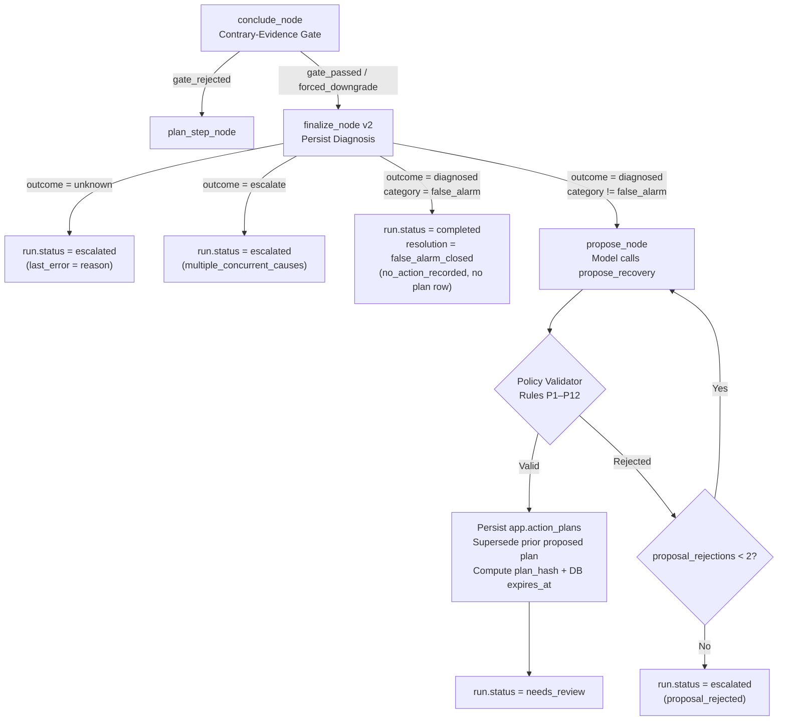

# OpsPilot Action Proposal & Policy Validator Design Specification

> **Specification Status**: Approved Architecture Specification (Feature 7)  
> **Target Document**: `docs/proposal_design.md`  
> **Relevant Contracts**: [docs/outcome_contract.md](outcome_contract.md), [docs/data_model.md](data_model.md), [docs/hypothesis_design.md](hypothesis_design.md), [docs/baseline_design.md](baseline_design.md), [shared/actions.py](../shared/actions.py), [docs/lab_design.md](lab_design.md), [docs/DECISIONS.md](DECISIONS.md)  
> **Implementation Stance**: Updated with Section 12 decisions. Awaiting approval before Phase 7.2.

---

## 1. Graph Placement & Outcome Routing

In the v2 investigator graph ([agent/graph/graph.py](../agent/graph/graph.py)), `finalize` (`finalize_node`) hands off `diagnosed` non-false-alarm runs to the **Action Proposal** subgraph (replacing `DefaultHandoffStub`):

```
finalize (v2) [outcome == "diagnosed", category != "false_alarm"]
  ──► propose node (LLM emits propose_recovery)
        ──► policy validator (deterministic P1–P12)
              ├── PASS ──► persist action_plans + run_events ──► run.status = "needs_review"
              └── REJECT (typed code) ──► retry propose (up to MAX_PROPOSAL_RETRIES = 2)
                                            └── exhausted ──► run.status = "escalated"
```

### State & Graph Flow



### Non-Proposal Paths
- **`unknown`** (`insufficient_evidence`, `contradictory_evidence`, `evidence_unavailable`, `budget_exhausted`, `gate_not_satisfied`, etc.): `finalize` records `last_error` on `runs` and transitions directly to `escalated`. `propose` is never entered.
- **`escalate`** (`multiple_concurrent_causes`): `finalize` records `last_error` and transitions directly to `escalated`. `propose` is never entered.
- **`false_alarm`** (`diagnosed` with `outcome_reason = "false_alarm_no_action"`): Under Phase 6.7 **Option A** (approved), `finalize` transitions directly to `completed` with `resolution = "false_alarm_closed"` and emits a `no_action_recorded` event without entering `propose` or `needs_review` and without creating any `app.action_plans` row (see Section 9).

---

## 2. `propose_recovery` Input Contract & Trust Boundary

The model's proposal payload is strictly partitioned from server-derived fields. `ProposalInput` uses `ConfigDict(extra="forbid")` so any attempt by the model to supply a server-derived field is rejected at schema validation. Note sanitization and length capping (formerly `P13`) are handled directly in `ProposalInput` schema validation/sanitizing rather than as a policy rejection.

### 2.1 Model-Supplied Inputs (`ProposalInput`)

| Field | Type | Constraints | Description |
| :--- | :--- | :--- | :--- |
| `action` | `ActionType` | `rollback_service` \| `restart_service` | Canonical action from [shared/actions.py](../shared/actions.py). `no_action` and `escalate` are outcomes, never plans. |
| `service` | `str` | Non-empty, normalized lowercase | Target affected service name from the lab allowlist. |
| `expected_version` | `str` | Non-empty `VARCHAR(64)` | Target's current running version observed during investigation (e.g., `"v1.1.0"`). |
| `rationale_evidence_ids` | `list[str]` | Non-empty, max 8 items | Supporting `observations.evidence_id` references justifying this action. |
| `note` | `str` | Max 300 chars plain text | Concise plain-text operational note; control characters stripped and length-capped at schema validation. Treated as untrusted display text. |

### 2.2 Server-Derived Fields (`ActionPlan`, Model Can Never Set)

| Field | Derivation Source | Description |
| :--- | :--- | :--- |
| `tenant_id` | `TenantContext` | Tenant isolation boundary from authenticated run context. |
| `run_id` | Graph / `RunService` context | Owning investigation run ID. |
| `plan_id` | Server UUID/ULID generator | Unique plan identifier (`plan_<id>`). |
| `target_id` | Static target registry lookup | Exact lab target identifier mapped from `service` (Rule P4). |
| `rollback_to_version` | `lab.deploys` lookup | Immediately previous deployed version for `rollback_service`; `NULL` for `restart_service`. |
| `rollback_route` | Deterministic server template | Structured/formatted undo instructions derived from `action`, `service`, and `expected_version`. |
| `created_at` | PostgreSQL `clock_timestamp()` | Authoritative DB insertion timestamp. |
| `expires_at` | PostgreSQL `clock_timestamp() + make_interval(secs => :ttl)` | Authoritative DB expiration timestamp using `APPROVAL_TTL_SECONDS`. |
| `plan_hash` | Server SHA-256 computation | Canonical digest over server + validated fields (Section 5). |
| `status` | Server state machine | Initialized strictly to `'proposed'`. |

> [!NOTE]
> `docs/data_model.md` Section 2.4 (`action_plans`) already defines `id`, `run_id`, `tenant_id`, `action`, `service`, `expected_version`, `rationale_evidence_ids`, `rollback_route`, `plan_hash`, `status`, `notes`, `expires_at`, `created_at`, `updated_at`. Feature 7's Alembic migration will add `target_id` (`VARCHAR(64) NOT NULL`) and `rollback_to_version` (`VARCHAR(64) NULL`) to `app.action_plans`.

---

## 3. Allowed Action Classes (v1)

Only two active recovery action classes are permitted in v1:

1. **`rollback_service`**: Reverts a deployable lab application service (`orders`, `inventory`, `gateway`) to the immediately previous deployed version recorded in `lab.deploys`.
2. **`restart_service`**: Executes an in-process reset of the affected service's dependency client state (pools, cache client, stuck connections) via `POST /admin/actions/restart`. It is **never** a container restart (no Docker socket) and **never** targets `redis` directly.

### Explicitly Disallowed in v1
The validator and broker categorically reject:
- **Scaling**: Horizontal replica changes or CPU/memory resource limit edits.
- **Configuration edits**: Environment variable mutations, feature flag toggles, or config file writes.
- **Arbitrary commands**: Shell execution (`bash`, `sh`), `docker exec`, or ad-hoc SQL queries.
- **Multi-service actions**: Any plan targeting more than one service or sequencing multiple actions.
- **Deploying new code**: Forward deployments, hotfixes, or deploying any version other than the immediately previous version in `lab.deploys`.
- **Non-lab targets or datastore targets**: Any action touching host OS processes, `core` API/Postgres/checkpoint stores, cloud APIs, Kubernetes, external endpoints, or `redis`/`postgres` directly (`redis` is never an action target).

---

## 4. Policy Validator Rules (`P1`–`P12`)

Every `ProposalInput` passes through a deterministic, non-LLM Policy Validator (with `note` sanitization and length capping enforced beforehand in `ProposalInput` schema validation). Failure returns a typed `PolicyRejection(code, rule, message, details)` to the graph.

| Rule ID | Typed Rejection Code | Deterministic Check |
| :--- | :--- | :--- |
| **P1** | `diagnosis_required` | Run must have a persisted `diagnoses` row with `outcome_kind == "diagnosed"`, Contrary-Evidence Gate passed, and `root_cause_category != "false_alarm"`. |
| **P2** | `action_consistent_with_diagnosis` | `(root_cause_category, mechanism)` must permit the proposed `ActionType` per the consistency table below. |
| **P3** | `service_matches_diagnosis` | Normalized `service` must match `diagnoses.root_cause_service`. For `dependency_failure`, the action `service` is the **affected** service (e.g., `inventory`), never `redis`; `redis` is recorded as the dependency in `mechanism`. |
| **P4** | `target_allowlisted` | `service` must resolve to **exactly one** `target_id` in a fixed static registry file (e.g., `shared/lab_targets.json`). Unknown or ambiguous names fail. |
| **P5** | `precondition_current` | `expected_version` must equal the target's live active version queried at validation time from `lab.deploys` / target profile endpoint. |
| **P6** | `rollback_possible` | For `rollback_service`, a prior deployed version (`rollback_to_version`) must exist in `lab.deploys` and satisfy `rollback_to_version != expected_version`. |
| **P7** | `evidence_valid` | `rationale_evidence_ids` is non-empty ($\le 8$ items); every ID exists in `app.observations` for this `run_id`, falls within the incident window, originates from an allowed read tool, and shares $\ge 1$ ID with `diagnoses.evidence_ids`. |
| **P8** | `one_active_plan` | At most one non-terminal plan (`status = 'proposed'`) may exist per `run_id`. A new valid proposal atomically transitions any prior `proposed` plan to `superseded` in the same DB transaction (backed by a partial unique index `WHERE status = 'proposed'`). |
| **P9** | `no_recent_action` | The target's own `last_action_at` must not be within the last `ACTION_COOLDOWN_MINUTES` (`10` minutes default, from config), preventing flapping. `last_action_at` resets when the lab world resets. |
| **P10** | `single_effect` | Exactly one scalar `service` and one scalar `action`; no batching, arrays, or compound parameters. |
| **P11** | `culprit_deploy_mismatch` | **Reason**: Prevents rolling back the wrong deploy if a benign deploy occurred after the culprit. For `rollback_service` when `diagnoses.culprit_deploy_id` is set, `expected_version` must match the version of the active deployment associated with `culprit_deploy_id` (or the latest deploy must be the culprit). |
| **P12** | `action_unsupported_by_target` | **Reason**: Only deployable application services (`gateway`, `orders`, `inventory`) are valid targets; datastores (`redis`, `postgres`) are never action targets in v1. |

### P2 Consistency Table

| `root_cause_category` | `mechanism` | Permitted `ActionType` |
| :--- | :--- | :--- |
| `bad_deploy` | `connection_pool_exhaustion`, `cache_bypass_latency` | `rollback_service` only |
| `dependency_failure` | `dependency_timeout` *(dependency: `redis`)* | `restart_service` only *(on affected service, e.g. `inventory`)* |
| `false_alarm` | `none` | *(none — handled in `finalize`, never enters `propose`)* |
| `unknown` | `unknown` | *(none — escalated in `finalize`, never enters `propose`)* |

---

## 5. Canonical `plan_hash` Specification

`plan_hash` is a 64-character lowercase hex SHA-256 digest computed strictly by one shared function (`shared.plans.plan_hash`) used by the application, policy validator, and DB verification:

```json
{
  "action": "rollback_service",
  "expected_version": "v1.1.0",
  "expires_at": "2026-11-25T13:36:15.123456Z",
  "rationale_evidence_ids": ["ev_deploys_a9c5af05", "ev_logs_7fd9920a"],
  "rollback_to_version": "v1.0.0",
  "run_id": "run_7a8b9c1d",
  "service": "orders",
  "target_id": "lab-orders",
  "tenant_id": "tenant-default"
}
```

### Canonical Encoding Rules
1. `rationale_evidence_ids`: deduplicated and sorted lexicographically (`sorted(set(ids))`).
2. `rollback_to_version`: string version for `rollback_service`, or `null` for `restart_service`.
3. `expires_at`: UTC ISO-8601 string formatted consistently with `Z` suffix (`dt.astimezone(timezone.utc).strftime("%Y-%m-%dT%H:%M:%S.%fZ")`).
4. Serialization: `json.dumps(canonical_obj, sort_keys=True, separators=(",", ":"), ensure_ascii=False).encode("utf-8")`.
5. Digest: `hashlib.sha256(encoded_bytes).hexdigest()`.
6. Unhashed fields (such as `note` / `notes`, `status`, `plan_id`) are **excluded** from `plan_hash`.

### Why `expires_at` Is Inside `plan_hash`
Including `expires_at` cryptographically binds the approval's validity window to the exact plan commitment. Without `expires_at` in the hash, a stale UI client or a mutated DB row could extend `expires_at` after proposal without invalidating the reviewer's signed `submitted_plan_hash`, allowing replay of an expired approval.

---

## 6. Expiry & Single DB Time Source

- **Configuration**: `APPROVAL_TTL_SECONDS` read from environment settings (default: `900` seconds / 15 minutes, per [docs/outcome_contract.md](outcome_contract.md)).
- **One DB Time Source Everywhere**: PostgreSQL `clock_timestamp()` is the **sole** clock used everywhere for expiry—at plan creation (`clock_timestamp() + make_interval(secs => :ttl)`), at human approval (`clock_timestamp() <= action_plans.expires_at`), and in the background expiry reaper (`clock_timestamp() > action_plans.expires_at`). Application clocks (`datetime.now()`) are never used for expiry decisions, eliminating clock skew across API, worker, reaper, and broker containers.

---

## 7. Rollback Route (Undo Metadata)

`rollback_route` is stored strictly as **data** on `app.action_plans` for human visibility and auditability. Undoing an executed action is **never automatic**; it requires a new incident/run or a new proposal that goes through the full Policy Validator and human approval flow.

| Proposed Action | Stored `rollback_route` Data |
| :--- | :--- |
| `rollback_service` (`expected_version` $\to$ `rollback_to_version`) | `Re-deploy <service> <expected_version> (new proposal required)` |
| `restart_service` (`service`) | `None — idempotent client-state reset; escalate or re-investigate if degraded` |

---

## 8. Review Screen Contract (Facts vs. Untrusted Prose)

The Review UI (`apps/web`) must render its decision surface from **verified database facts**, never from free-form model prose:

- **Verified Fact Fields (Authoritative)**:
  - **Diagnosis**: `root_cause_category`, `mechanism`, `root_cause_service`, `culprit_deploy_id`, deterministic `confidence` (and cap rule ID from `diagnoses`).
  - **Proposed Action**: `action`, `service`, `target_id`, version transition (`expected_version` $\to$ `rollback_to_version`), `rollback_route`.
  - **Cryptographic & Timing**: `plan_hash`, `created_at`, `expires_at` (live DB-anchored TTL countdown), and target cooldown status (`last_action_at`).
  - **Evidence**: `observations` rows matching `rationale_evidence_ids` and `diagnoses.evidence_ids` (tool name, time window, deterministic summary, `content_hash`).
- **Model Note (`action_plans.notes`)**:
  - Capped at $\le 300$ characters, stripped of control characters at schema validation, and HTML-escaped.
  - Rendered in a separate callout explicitly labelled **`Untrusted AI Note`** so reviewers never mistake model rationale for verified telemetry.

---

## 9. State Machine Outcomes & False-Alarm Branch (Phase 6.7 Option A)

| Outcome | Reason Code | State Transition | `runs.resolution` | Proposal / Plan Behavior |
| :--- | :--- | :--- | :--- | :--- |
| `diagnosed` (active fault) | `concluded_by_model` | `investigating` $\to$ `needs_review` | `NULL` (until `recovered` / `escalated` / `failed`) | Enters `propose` $\to$ Policy Validator $\to$ persists `action_plans` (`proposed`). |
| `diagnosed` (false alarm) | `false_alarm_no_action` | `investigating` $\to$ `completed` | `false_alarm_closed` | **Option A**: `finalize_node` transitions directly to `completed` and emits `no_action_recorded` in `run_events`. **No `action_plans` row is created.** |
| `unknown` | `insufficient_evidence`, `contradictory_evidence`, `evidence_unavailable`, `budget_exhausted`, `gate_not_satisfied` | `investigating` $\to$ `escalated` | `escalated` | Skips `propose`; records `last_error` on `runs`. |
| `escalate` | `multiple_concurrent_causes` | `investigating` $\to$ `escalated` | `escalated` | Skips `propose`; records `last_error` on `runs`. |

### Phase 6.7 Invariants Confirmed
- **(a) DB Trigger Guard**: `app.fn_runs_enforce_transition()` ([84d5e6f7a8b9_false_alarm_resolution_and_trigger.py](../infra/alembic/versions/84d5e6f7a8b9_false_alarm_resolution_and_trigger.py)) permits `investigating -> completed` **only** when `app.diagnoses` contains a gate-passed `false_alarm` diagnosis (`root_cause_category = 'false_alarm'`, `outcome_kind = 'diagnosed'`, `outcome_reason = 'false_alarm_no_action'`).
- **(b) No `action_plans` Row for `no_action`**: `finalize_node` ([finalize.py](../agent/graph/nodes/finalize.py)) records `no_action_recorded` in `app.run_events` without inserting into `app.action_plans`, and `shared/plans.py` forbids `no_action`/`escalate` from becoming `ActionPlan` instances.
- **(c) `resolution` Field**: `app.runs.resolution` stores `'false_alarm_closed'` for Option A false-alarm closures so evaluation and recovery metrics exclude `false_alarm_closed` runs cleanly. `TERMINATION_STATUS_MAP` in [agent/graph/state.py](../agent/graph/state.py#L54) is updated to `"completed"`.

---

## 10. Semantics of `restart_service` in the Lab

- **Action Semantics**: `restart_service` performs an **in-process reset of the affected service's dependency client state** (connection pools, cache client handles, stuck connections) via `POST /admin/actions/restart`. It is **not** a container restart (no Docker socket) and **not** a fault-reset endpoint.
- **Lab Modeling Choice (S3/F3)**: The S3 `dependency_timeout` fault is modeled as client-side state inside the affected service (`inventory`) so that an in-process `restart_service` genuinely clears the stuck client state and restores baseline behavior.
- **Broker Least-Privilege Token Scope**: The `broker` authenticates with a scoped token valid **only** for `/admin/actions/*`. Control-plane endpoints `/admin/faults`, `/admin/deploy`, and `/admin/reset` remain strictly `fault-controller`-only.
- **How Feature 10's Verifier Detects Success**:
  1. Independent probe runner executes 3 consecutive health checks (`GET /healthz`, `POST /ping`) expecting HTTP 200 within 100ms.
  2. Synthetic checkout traffic (`POST /checkout`) runs over a 30s evaluation window, verifying $E_{post} < 0.5\%$ and $L_{post} \le 1.20 \times L_{baseline}$.

---

## 11. Metrics to Report

Feature 7 evaluation and telemetry will report:
1. **`proposals_per_run`**: Mean proposal attempts per `diagnosed` run (ideal: `1.00`; $>1.0$ indicates validator rejections/retries).
2. **`rejections_by_code`**: Histogram of Policy Validator rejections keyed by typed code (`P1`–`P12`).
3. **`wrong_action_caught_by_validator_vs_human`**: Count and share of incorrect/unsafe proposals blocked deterministically by the Policy Validator vs passed by the validator and rejected by human reviewers in `needs_review`.
4. **`unnecessary_action_rate`**: Percentage of runs where an active mutation (`rollback_service` or `restart_service`) was proposed/approved when ground truth was `no_action` or targeted a healthy service ([docs/baseline_design.md](baseline_design.md#L204-L217), target $\le 5\%$).

---

## 12. Recorded Decisions

All Section 12 design decisions are locked as follows:
1. **Model-Proposed Action + Deterministic Validator**: Approved. Model calls `propose_recovery`; Policy Validator (`P1`–`P12`) validates deterministically.
2. **Phase 6.7 Option A**: Approved. `TERMINATION_STATUS_MAP` updated (`FALSE_ALARM_NO_ACTION -> "completed"`), DB trigger guards `investigating -> completed`, no `action_plans` row for `no_action`, and `runs.resolution = "false_alarm_closed"` added.
3. **`P3` for `dependency_failure`**: Action `service` is the **affected** service (`inventory`). `redis` is never an action target; `redis` is recorded as the dependency in `mechanism`.
4. **`restart_service` Semantics**: In-process reset of affected service's dependency client state via `POST /admin/actions/restart` with broker token scoped to `/admin/actions/*`; S3 fault modeled as client-side state.
5. **Cooldown & Retry Defaults**: `MAX_PROPOSAL_RETRIES = 2`; `ACTION_COOLDOWN_MINUTES = 10` computed from the target's own `last_action_at`, which resets with the lab world.
6. **Schema Sanitizing & Clock**: `P13` (`note` sanitization/length cap) is handled at `ProposalInput` schema validation; PostgreSQL `clock_timestamp()` is the single time source everywhere for expiry.
