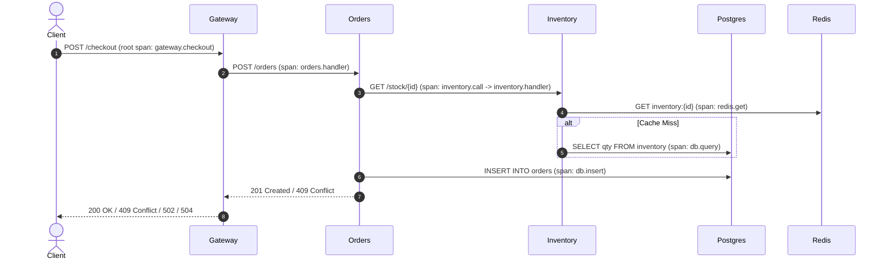

# Telemetry Architecture & Layout Specification

## Overview

OpsPilot maintains an observable telemetry plane designed to mirror production-grade telemetry architectures while preserving strict resource boundaries and security isolation. The telemetry stack collects metrics, distributed traces, and structured logs across all synthetic lab services (`gateway`, `orders`, and `inventory`).

---

## Storage Layout (`telemetry` Volume)

All runtime execution evidence is persisted to a dedicated Docker named volume (`telemetry`). The filesystem structure within the volume is organized as follows:

```
/telemetry/
├── logs/
│   ├── gateway.jsonl       # Structured JSON logs emitted by the gateway service
│   ├── orders.jsonl        # Structured JSON logs emitted by the orders service
│   └── inventory.jsonl     # Structured JSON logs emitted by the inventory service
└── traces/
    └── spans.jsonl         # JSONL span stream exported by OpenTelemetry Collector
```

### Access Control and Permission Boundaries

To ensure data integrity and prevent tampering:
1. **Read-Write Access (`:rw`)**: Only the telemetry-generating microservices (`gateway`, `orders`, `inventory`) and the telemetry collector (`otel-collector`) mount `/telemetry` with write privileges.
2. **Read-Only Access (`:ro`)**: Any diagnostic tool, investigation agent, broker worker, or audit container mounts `/telemetry` strictly in read-only mode (`:ro`).
3. **No Docker Socket**: No telemetry container or service has access to the Docker socket (`/var/run/docker.sock`).

---

## Metrics Collection (Prometheus)

Prometheus (`prom/prometheus:v2.54.1`) collects time-series telemetry on a dedicated loop:
- **Scrape Interval**: 5 seconds.
- **Evaluation Interval**: 5 seconds.
- **Targets**: `gateway:8000/metrics`, `orders:8000/metrics`, `inventory:8000/metrics`.
- **Retention**: 2 days (`--storage.tsdb.retention.time=2d`).
- **TSDB Volume**: Dedicated named volume `prometheus_data` mounted at `/prometheus`.
- **Network Isolation**: Operates exclusively on internal `lab` network with no published external ports.

### Standard Lab Prometheus Metrics
- `http_requests_total{service, route, status}`: Total HTTP requests received.
- `http_request_duration_seconds_bucket{service, le}`: Histogram of request duration (5ms to 5s buckets).
- `dependency_call_duration_seconds_bucket{dependency, le}`: Downstream dependency latency histogram.
- `dependency_errors_total{dependency}`: Count of dependency failures encountered.
- `db_pool_in_use{service}`: Number of currently leased database connections.
- `db_pool_size{service}`: Total configured database connection capacity.
- `db_pool_wait_seconds_bucket{service, le}`: Connection pool wait duration histogram.

---

## Distributed Tracing (OpenTelemetry Collector)

OpenTelemetry Collector Contrib (`otel/opentelemetry-collector-contrib:0.108.0`) aggregates distributed spans:
- **Receivers**: OTLP over gRPC (`0.0.0.0:4317`) and HTTP (`0.0.0.0:4318`).
- **Processors**: Batch processor configured for low latency (`timeout: 1s`, `send_batch_size: 1`).
- **Exporters**: File exporter streaming JSONL records to `/telemetry/traces/spans.jsonl`.
- **Trace Context Propagation**: W3C `traceparent` (`tracecontext`) header passed across HTTP client and server hops.

### Distributed Call Hierarchy
A single customer checkout produces a correlated distributed trace tree across all 3 services:


---

## Log & Span Correlation

OpsPilot correlates logs with traces through two standard fields:
- `trace_id`: 32-character lowercase hexadecimal string (128-bit W3C trace ID).
- `span_id`: 16-character lowercase hexadecimal string (64-bit W3C span ID).

### Log Record Schema (`/telemetry/logs/<service>.jsonl`)
```json
{
  "ts": "2026-11-23T09:15:32.145678Z",
  "service": "orders",
  "version": "v1.0.0",
  "level": "INFO",
  "event": "order_created",
  "msg": "Order processed successfully",
  "request_id": "req-98fbc10d-2a81",
  "trace_id": "4bf92f3577b34da6a3ce929d0e0e4736",
  "span_id": "00f067aa0ba902b7",
  "product_id": 1,
  "qty": 1
}
```

### Trace Span Record Schema (`/telemetry/traces/spans.jsonl`)
In OpenTelemetry Collector JSON format, span records contain corresponding trace IDs:
```json
{
  "resourceSpans": [
    {
      "resource": {
        "attributes": [
          {"key": "service.name", "value": {"stringValue": "orders"}},
          {"key": "service.version", "value": {"stringValue": "v1.0.0"}}
        ]
      },
      "scopeSpans": [
        {
          "spans": [
            {
              "traceId": "4bf92f3577b34da6a3ce929d0e0e4736",
              "spanId": "00f067aa0ba902b7",
              "parentSpanId": "5fb397be34d23b0f",
              "name": "orders.handler",
              "kind": 2
            }
          ]
        }
      ]
    }
  ]
}
```

---

## Grafana Visualization (Optional)

Grafana (`grafana/grafana:11.2.0`) is included strictly for human operators and is excluded from automated agent evaluation tools:
- **Port**: Published strictly on local loopback `127.0.0.1:3000`.
- **Datasource**: Pre-provisioned to Prometheus at `http://prometheus:9090`.
- **Pre-provisioned Dashboard**: `opspilot-lab-overview` (`infra/grafana/provisioning/dashboards/lab_overview.json`).
  - **Request Rate (req/s)**: `sum(rate(http_requests_total[1m])) by (service)`
  - **Error Rate (%)**: `100 * sum(rate(http_requests_total{status=~"5.."}[1m])) by (service) / sum(rate(http_requests_total[1m])) by (service)`
  - **p95 Latency (s)**: `histogram_quantile(0.95, sum(rate(http_request_duration_seconds_bucket[1m])) by (le, service))`
  - **DB Pool In Use**: `db_pool_in_use`
